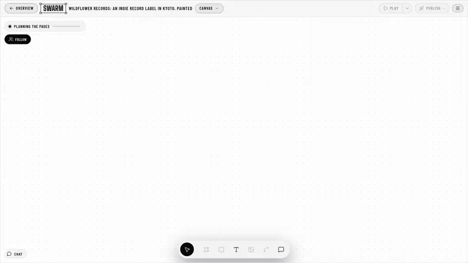
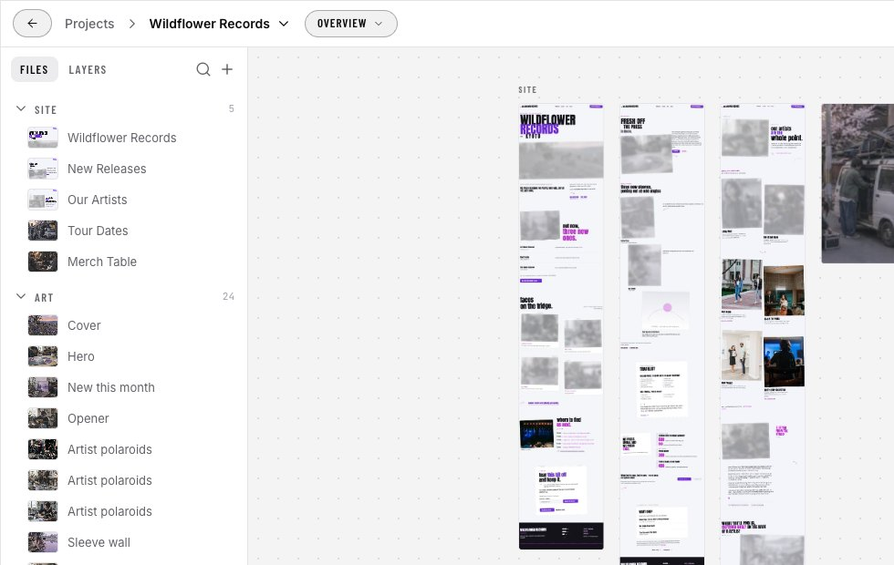
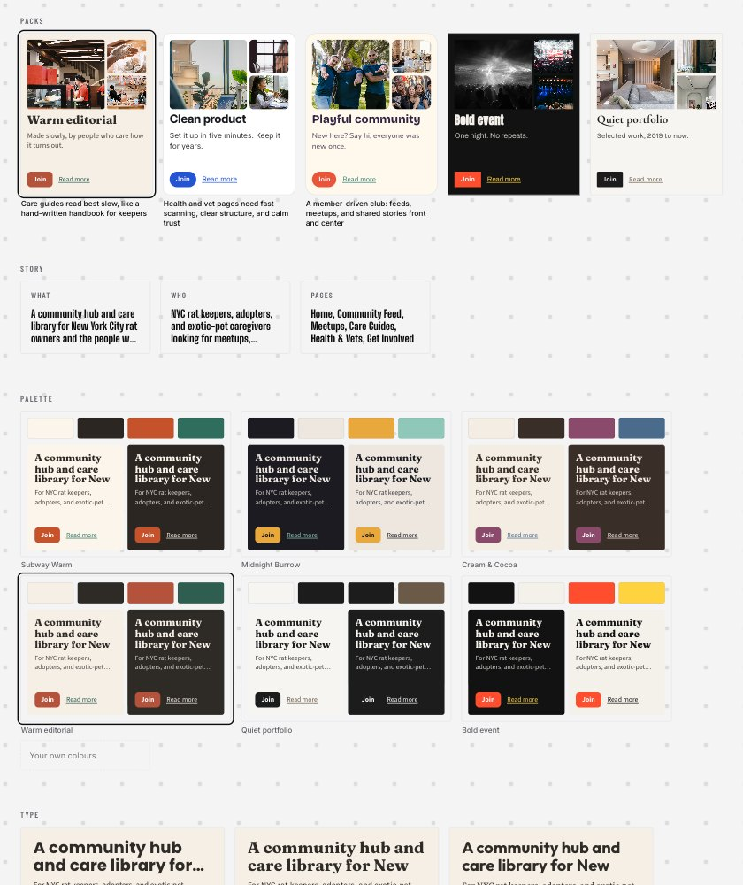
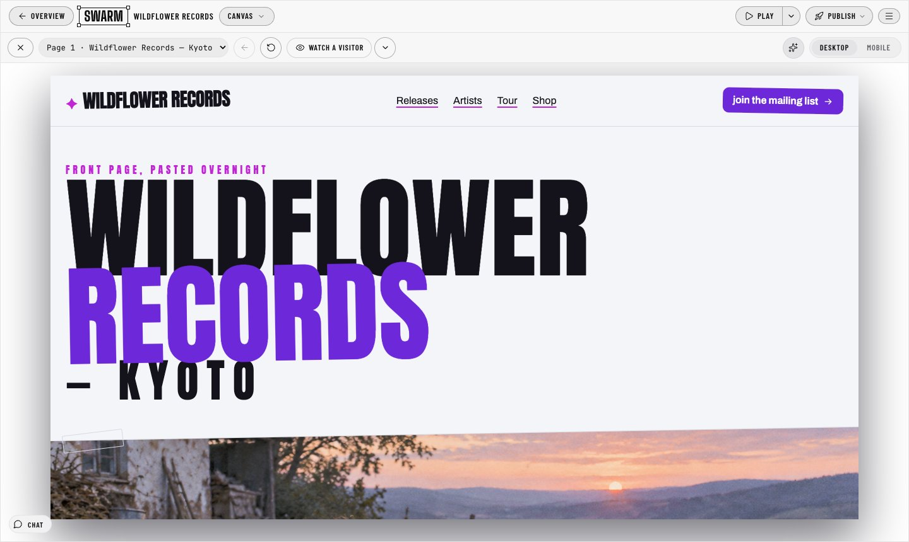
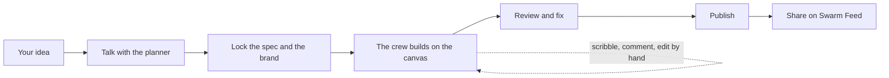
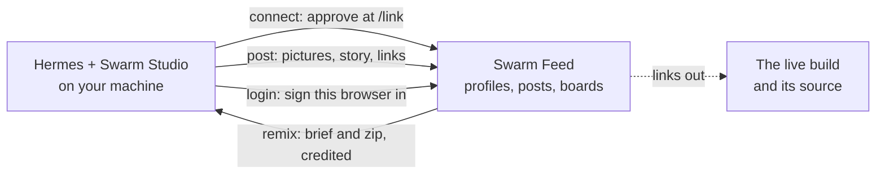

<p align="center">
  
</p>

<h1 align="center">Swarm Studio</h1>

<p align="center"><b>Built for Hermes Agent.</b></p>

<p align="center">
  
</p>

<p align="center"><i>A real build, sped up: Wildflower Records, 5 pages and 28 sections by 16 agents in 27 seconds.</i></p>

A plugin for [Hermes Agent](https://github.com/NousResearch/hermes-agent). You describe a product, talk it through with a planner, and a crew of agents builds the site, the app, the game or the film on a canvas where you can watch and steer them.

```bash
hermes plugins install Pukujan/swarm-studio --force
hermes plugins enable swarm-studio
```

(Why `--force`, and what the plugin does on your computer, are [further down](#install).)

<table>
  <tr>
    <td width="33%"></td>
    <td width="33%"></td>
    <td width="33%"></td>
  </tr>
  <tr>
    <td align="center"><b>Overview</b>: every page and picture of a project</td>
    <td align="center"><b>Brand sheet</b>: story, palette and type before the design</td>
    <td align="center"><b>Play</b>: the finished site as a working prototype</td>
  </tr>
</table>

## Who it's for

- **A founder who needs a launch this week.** One brief gets you a multi-page site with copy and pictures, a promo film and a share picture, online on your own GitHub, Vercel or Cloudflare account.
- **A designer who wants a first pass to react to.** A brand sheet with palettes and type to choose from, then a full design you can scribble on, comment on or change by hand, with every version kept.
- **A developer who needs the front end and an app shell.** Clean HTML and Tailwind, a React + Vite export, and a working app with server routes, forms that save and an admin table.
- **A game maker.** A plan that follows the genre and size you ask for, painted sprites cut out to transparent PNGs, and a browser game the crew play-tests before you see it.
- **A marketer who needs the site, film and posts to match.** One brand drives the pages, the promo film and the share pictures, and posts go to Swarm Feed.
- **Someone new to all of it.** You can just talk. The planner asks what it needs, and nothing builds until you say so.

## What it does

| Area | What you get | Status |
|---|---|---|
| **Talk before building** | Talk the idea through with the planner. It asks only what your prompt left out, and **Lock** turns the talk into the spec the crew builds from. Nothing builds unasked. | works |
| **Brand sheet and packs** | The story, palettes, type pairings, voice and pictures side by side before anything is designed. Five ready-made packs to use whole or mix by part. Locking it makes it the build's theme. | works |
| **The crew** | 8 agents by default (2 to 24) build sections on one canvas at the same time. Each has a cursor, a name and a note about what it is doing. | works |
| **Chats** | Each talk with the planner is its own chat, and moves into the project when it builds. | works |
| **References** | A project's own store of pictures, clips and links. **Use for…** sends one to the crew for a part of the site. | works |
| **Scribble** | Draw on a page. A vision model reads each mark and the area it covers, and the crew answers with a draft beside the original to accept or dismiss. | works |
| **Drag a layer into the chat** | Drag a section into the chat and a line joins it to the message. The crew changes just that section. | works |
| **Manual edit** | Pick any part of a section and change its words, link, picture, style or attributes, or move or remove it. Each change is a version you can undo, and the crew keeps it when it reworks that section. | works |
| **Media reader** | Pictures you give it are looked at, links are read as pages, and clips and sounds are watched and listened to when you pick a media model. The chat says how each one was read. | works |
| **Review** | Every page is checked at desktop and phone width, by measuring the page and by a vision model, and the crew fixes what it finds. | works |
| **Play and Watch a visitor** | Every page wired into a clickable prototype on desktop or phone. **Watch a visitor** plays 3 or 4 people with different goals using the site. | works |
| **Stop** | One button stops the crew. What is built is kept, and Resume finishes it. | works |
| **Search and share** | Every page gets its own search title, description and share picture. Every site gets its own favicon and app icon, `robots.txt`, `sitemap.xml` and a 404 page. | works |
| **Publish** | GitHub Pages (each version of a project gets its own link), Vercel, Cloudflare Pages, or this computer. | works |
| **Working app** | The design becomes a full-stack app (React, server routes, sign-in, forms, an admin page) and deploys to Vercel. | works |
| **Film director** | A promo film from the site's own copy and pictures. There are six kinds of film, each with its own acts, and the cuts land on the music. | works |
| **Games** | Plans that follow the genre, the size and the engine. Browser games in three.js, Phaser or PixiJS, play-tested by the crew. Painted art, cut out cleanly. A Godot 4 project when Godot is installed. | works (Unity and Unreal ports are source only) |
| **Swarm Feed** | Post a build with its pictures and story; others remix it with credit. | works |
| **Swarm Jams** | Jam events: a theme, a deadline, entries and votes. | first version |

Every feature, with its canvas button and `/swarm` command: [FEATURES.md](FEATURES.md).

## How it works



1. **Idea.** Type what you want to make: a website, an app, a game or a film.
2. **Talk.** The planner asks what it needs to know and suggests a brand sheet.
3. **Lock.** You pick the look and lock the spec. Nothing is built before this.
4. **Build.** The planner splits the pages into sections, and the crew builds them on one canvas at once. You can scribble, comment, drag a section into the chat or edit by hand while it works.
5. **Review.** Each page is checked at desktop and phone width, and problems are fixed.
6. **Publish.** One click puts it online on your own account.
7. **Share.** Post it to Swarm Feed, where others see it and can remix it.

## How Swarm Studio and Swarm Feed fit together

Swarm Studio is the Hermes plugin that makes things: a site, a game, an app or a film, built by a swarm of agents on your machine. Swarm Feed (swarm.design-bakery.com) is where people show what they made: one card per project, with its pictures, story and links out to the live build and its source. The Feed shows builds and links to them; it doesn't host or run them. The plugin only talks to the Feed when you ask it to: when you connect, post, remix or sign in.



- `/swarm connect` links this computer to your [Swarm Feed](https://swarm.design-bakery.com) account (a code you approve at /link).
- **Post to Feed** (`/swarm post`) shares a published build: its pictures, story, page shots and links out to the live site and its files.
- `/swarm remix <id>` starts your own take on a Feed build from its brief. Posting the remix names the original.
- `/swarm login` signs your browser in to the Feed as you.
- Nothing is sent unless you connect, post, remix or log in. The full list of what is sent is under [What it does on your machine](#what-it-does-on-your-machine).

## More coming

Not built yet, unless a line says otherwise. No dates.

- **Studio mode:** a kit for each kind of thing you make (site, app, game, film, deck).
- **Brand as the project's foundation:** one brand that every build in a project starts from.
- **Decks:** slides from the same brand and story.
- **Video straight from a brand,** without a site first.
- **Game starters:** ready-made beginnings for common genres.
- **One navigation state machine** for the whole Studio. The first part is in; the rest is coming.
- **App stores and Steam:** publishing apps and games beyond the web.
- **Shared boards and events:** boards where a team pins notes for the crew, and online or in-person events.

The pitch, brand, market numbers and stories live in [docs/brand](docs/brand/): [PITCH.md](docs/brand/PITCH.md), [BRAND.md](docs/brand/BRAND.md), [MARKET.md](docs/brand/MARKET.md) and [stories-swarm-studio.md](docs/brand/stories-swarm-studio.md).

## Ways to use it

| Where | How |
|---|---|
| Hermes Desktop | **Swarm Studio** in the sidebar opens the canvas as a page, and a `swarm` pane can sit beside the chat. A status-bar chip shows how many agents are working. |
| Any Hermes chat | Ask for a site. The agent calls the `swarm_design` tool and gets back the run summary and the canvas URL. |
| Slash command | `/swarm <what the site is for>` starts a build without going through the model. |
| Terminal | `hermes swarm "a climbing gym in Cornwall" --wait` |
| Skill | `swarm-studio:swarm-design` tells the agent when to use the swarm and how to write a good brief. |

See [FEATURES.md](FEATURES.md) for everything it does, with the canvas button and `/swarm` command for each.

## Install

```bash
hermes plugins install Pukujan/swarm-studio --force
hermes plugins enable swarm-studio
```

Why `--force`: Hermes scans every plugin on install. This repo vendors the dyad app engine, whose dev files
(its CI workflows, test fixtures and docs that list blocked commands such as `rm -rf /`) match the scan's
patterns, so the verdict is CAUTION and a plain install stops with `Decision: BLOCKED … Use --force to
override.` In a terminal it instead lists the findings and asks
`Install anyway? Only continue if you trust the source. [y/N]:`, where `y` does the same as `--force`.
`--force` accepts a CAUTION verdict only; Hermes still refuses a DANGEROUS one.

That's it: the swarm uses the models you already set up in Hermes. Check with:

```bash
hermes swarm --models
```

In Hermes Desktop, turn on **Swarm Studio** under Capabilities → Plugins.

**After installing again or updating, restart Hermes.** A running Hermes keeps the copy of the plugin it
loaded, and the studio's model calls go through that copy. Run `hermes gateway restart`, or quit Hermes
Desktop and open it again. Until then the studio says "Swarm Studio was updated. Restart Hermes to finish."
and does not start a build. With no Hermes open at all it says "Hermes isn't connected." instead.

Requires Node.js 18 or newer on `PATH` (or set `SWARM_STUDIO_NODE`). Today it installs no npm packages: the libraries it uses are vendored in `web/vendor/`. (`tools/dev/package.json` holds the development checks, the type check and the dependency rules, and the design-token build; it is not at the plugin's root, so installing the plugin never installs it.) Works on macOS, Linux and native Windows.

## Models

The plugin adds two slots to Hermes's model picker (`hermes model`, or Desktop's model settings), stored as `auxiliary.<slot>` in your Hermes config:

| Slot | Used for | Until you pick one |
|---|---|---|
| **Swarm Studio planner** (`swarm_studio_planner`) | the sitemap and page planners, a few calls per build | your main model |
| **Swarm Studio builders** (`swarm_studio_builder`) | the parallel section agents, most of the calls | your compression model, which is usually a fast, cheap one |

When a build starts, Hermes resolves each slot to an endpoint, key and model and hands them to the swarm process. The slot's provider must speak the OpenAI `/chat/completions` API, since the builders stream. If it doesn't (Anthropic, Bedrock or Codex clients), `hermes swarm --models` says so; pick an OpenAI-compatible provider for that slot or set `SWARM_STUDIO_API_KEY`.

## Settings

Optional. Setting `SWARM_STUDIO_API_KEY` bypasses the Hermes slots and uses that key with `SWARM_STUDIO_BASE_URL`. The model variables override the model in either case.

| Variable | Default | What it does |
|---|---|---|
| `SWARM_STUDIO_API_KEY` | unset | Use this key instead of the Hermes slots. Read through Hermes's secret store. |
| `SWARM_STUDIO_BASE_URL` | `https://api.inferhub.dev/v1` | Any OpenAI-compatible `/chat/completions` endpoint. |
| `SWARM_STUDIO_PLANNER_MODEL` | the slot's model | Model for the sitemap and page planners. |
| `SWARM_STUDIO_WORKER_MODEL` | the slot's model | Model for the section agents. A fast model matters more than a big one. |
| `SWARM_STUDIO_AGENTS` | `8` | Crew size, 2–24. |
| `SWARM_STUDIO_PORT` | `4319` | Port of the local canvas server. |

## How a build runs, in detail

1. **Sitemap.** One streamed call writes the theme (colours, fonts, radius), the shared nav and footer, and the pages with their section lists.
2. **Page planners.** One planner per page runs in parallel and breaks its page into layers. Each layer is queued the moment its JSON is complete, so agents start before planning finishes.
3. **Agents.** A fixed pool of agents takes layers off the queue. Each streams HTML and Tailwind using the theme's CSS variables, plus a one-line note about what it is doing. Links between pages use `data-goto`, which becomes a wire on the canvas and a working link in the prototype.
4. **Canvas.** Each page is a sandboxed frame. The canvas talks to the frames only by `postMessage`, so it works inside Hermes Desktop's opaque-origin `SandboxedFrame`.
5. **Visitors.** In Play mode, **Watch a visitor** asks the planner model for 3–4 people with different goals (one wants to buy or book, one is unsure and ends up calling, one reads about the company). Their scripts can only use links, buttons, inputs and headings that exist on each page, and are checked against them. A cursor then acts each one out on Desktop or Mobile, with a thought bubble that cycles through two or three ways of saying the same thought. Scripts are saved with the run.
6. **Motion.** The prototype plays like a finished site: sections reveal as they scroll in (headings, copy, pictures and cards one after another), the first screen plays on load and buttons lift on hover. The theme's art direction picks the feel (a soft rise, or a quicker spring for bold and playful themes), and it respects reduced-motion settings. **✨ Motion** (or M) turns it off. The HTML and React exports ship the same script (`engine/motion.mjs`).

Runs are saved under `$HERMES_HOME/swarm-studio/runs/<run>/` (`plan.json` plus each layer's HTML).

## What it does on your machine

- **A background process.** The plugin starts a small Node server (`server/server.mjs`) the first time you use it. It listens on `127.0.0.1` only, and keeps running after Hermes closes, until it has had nothing to do for 20 minutes (no Studio open, no build, film or job; Settings › Background: 10, 20 or 60 minutes, or never). It then exits, and starts again the next time you use it. An app you open runs on its own `127.0.0.1` port: its dev server only while the crew builds or you edit it, otherwise its built files (or its built server, for an app with server routes). One nobody has looked at for 2 minutes stops (Settings › Background), at most 2 run at once, and each stops with every process it started. One film renders at a time. It refuses requests whose `Host` isn't `127.0.0.1` or `localhost`. Starting a run and reading the event stream both need a random token that is made per install and stored with mode `0600`.
- **Network calls.**
  - Model calls (your brief, the plan, the sections, page screenshots for the review) go to Hermes, which answers them with the models you picked for the Swarm Studio slots in `hermes model`, through its own provider and key. With no Hermes open, a build waits and the canvas says so. Only when you set `SWARM_STUDIO_API_KEY` does the server call `SWARM_STUDIO_BASE_URL` (InferHub by default) itself, with that key.
  - The **Setup** sheet (shown once, then in your menu on Projects) sends the words "Say ok" to your planner and builder models to check they answer. "Let Hermes set this up" opens `hermes model` in a terminal. Its Account row's Google, GitHub and Discord buttons open Swarm Feed's sign-in in your browser; once you sign in and press Connect, this computer posts to the Feed as that account. Skip it and nothing is sent.
  - The canvas and page frames load Tailwind from `cdn.tailwindcss.com` and fonts from Google Fonts.
  - Generated images go through Hermes's own `image_generate` tool, with the image backend you set in `hermes tools`; the visual review sends page screenshots to your reviewer slot's model through Hermes.
  - While a picture is being painted its slot shows a stock photo: the picture's prompt words are searched on Openverse (and Pexels, with a key), and photos from the studio's own library are fetched from `files.design-bakery.com` by the local server and kept in `$HERMES_HOME/swarm-studio/standins/`.
  - **Publish** to GitHub Pages runs your `gh` CLI: it creates a public repo under your account (its description says it was made with Swarm Studio, and it only ever updates repos marked that way) and pushes the static site. **Vercel** and **Cloudflare Pages** use an access token you connect once in the Publish menu (or `VERCEL_TOKEN` / `CLOUDFLARE_API_TOKEN`); it is checked with the provider and stored in `$HERMES_HOME/swarm-studio/connections.json` with mode `0600`, and never sent back to the canvas. You can paste an **Octo vault** grant (`octo_vault_…`) instead of a token: Swarm Studio finds the provider's item in your vault, keeps only a 30-day working key for that one item (renewed automatically, the grant itself is not stored), and every call goes through Octo's relay, so the provider token never leaves the vault. Both deploy through the provider's REST API (Cloudflare's direct upload, the same calls wrangler makes), with no extra tools to install. Publishing locally serves the site from the canvas server at `127.0.0.1:4319/site/<run>/`.
  - The first promo video installs `hyperframes`, and ffmpeg and ffprobe when they are not on `PATH`, from npm at exact versions into `$HERMES_HOME/swarm-studio/video-tools/`; the ffmpeg and ffprobe binaries are checked against recorded SHA-256 sums before they run. Rendering runs locally in headless Chrome. ffmpeg also writes one poster frame (a JPEG) beside each film, play-test clip and idle clip, which the boards show until the clip is played.
  - **Pictures** go through one image service: each is stored once by its content hash in `$HERMES_HOME/swarm-studio/images/`, a side over 4096 px is scaled down there (your own file is never changed), and the canvas asks for the size it shows (`/img/<hash>?w=256`, steps from 64 to 2048 px, each made once and kept), with a ThumbHash (about 30 bytes) for a blurred preview. The first picture it resizes installs [`@napi-rs/image`](https://github.com/Brooooooklyn/Image) 1.16.0 (MIT, a prebuilt binary for your platform) and `thumbhash` 0.1.1 (MIT) from npm, pinned by `engine/imagetools/package-lock.json`, into `$HERMES_HOME/swarm-studio/image-tools/` with `npm ci --ignore-scripts`: nothing is compiled and no install script runs. Until then, or with `SWARM_IMAGE_SERVICE=0`, pictures are served as they are.
  - The first **app** build installs the app engine (dyad's headless engine, vendored in `dyad/`, Apache-2.0 with `src/pro` under FSL) from npm into the plugin's `dyad/node_modules` (about 1.5 GB, once), and each app installs its own packages with `pnpm`. Apps run on a local Vite server on `127.0.0.1`. **App deploy** uploads the app's source to your Vercel account, which builds it.
  - **Game mode** reads its game-dev notes from the plugin (`gameskills/`); games make their art and sound in code, so nothing is downloaded for them. A game spec can also name 3D models (`"models": [{ "file": "Knight.glb", "what": "the hero" }]`) that you put in `$HERMES_HOME/swarm-studio/models/`; they are copied into the game and into its engine port.
  - **Bring in a project** (Projects › the kind menu) copies a folder from your home folder, or fetches a GitHub repository with your own `git` and `gh` login (the newest commit only, into a temp folder that is removed), into the studio's `runs/` folder: files only, at most 200 MB and 20,000 files, never `node_modules`, `.git`, build output or `.env` files. Nothing of the project is run while it comes in; a Vite project is installed (`pnpm install --ignore-scripts`) and built only when you press Install and run. Nothing is sent anywhere.
  - **Godot ports** are opened and run headless with your Godot 4 (`godot` on `PATH`, or `SWARM_GODOT` set to its executable) when it is installed, and Godot's errors get a fix turn.
  - **Swarm Feed** (only when you run `/swarm connect`, `post`, `remix` or `login`) talks to `https://swarm.design-bakery.com` (or `SWARM_FEED_URL`). `connect` sends a random install id and "Hermes on <computer name>"; `post` sends the build's title, brief, public link, page names, crew, a poster (a page shot or picture from the build) and caption, a desktop and a phone shot of each of its first 12 pages (taken on your computer from its export), then its export zip; `remix` downloads the original's prompt and zip into `$HERMES_HOME/swarm-studio/remix/` (kept, never unpacked or run). The feed token is stored in `$HERMES_HOME/swarm-studio/feed.json` with mode `0600` and never printed.
  - Nothing else leaves the machine.
- **Vendored code.** The studio's page includes [XState](https://github.com/statelyai/xstate) 5.33.3 (MIT), which keeps track of where you are in the studio. It is one file, `web/vendor/xstate/xstate.mjs`, built from the npm tarball by `scripts/vendor.mjs`; its version, source, licence and SHA-256 sit beside it. The plugin's own server puts it into the page. Nothing is downloaded or installed for it on your machine. The server bundles [execa](https://github.com/sindresorhus/execa) 9.6.1 (MIT) to start its child processes and [tree-kill](https://github.com/pkrumins/node-tree-kill) 1.2.2 (MIT) to stop each one with all its children: one file, `engine/vendor/procs/procs.mjs`, built by the same script from the pinned lockfile in `scripts/vendor/procs/` (their 22 dependencies are MIT, ISC and Apache-2.0; every licence is in `engine/vendor/procs/LICENSE`). Nothing is installed for it either.
- **The next Studio, prebuilt.** The Studio is moving to React one screen at a time. The plugin's server also serves `/next/`, a page built ahead of time (when the release is made, so the installed copy carries it in `ui/dist/`) with [React](https://react.dev) 19 (MIT), [React Aria](https://react-spectrum.adobe.com/react-aria/) (Apache-2.0), [XState](https://github.com/statelyai/xstate) 5.33.3 (MIT) and [Tailwind](https://tailwindcss.com)'s styles (MIT) inside it. Nothing is built, downloaded or installed for it on your machine; it talks only to the plugin's own server (for the Studio's fonts, and its API as screens move).
- **Files.** It writes only under `$HERMES_HOME/swarm-studio/`: the token, `server.log`, the runs (each with its pages' saved pictures in `snaps/`), your picks (`models.json`, `setup.json`), `connections.json` if you connect a host, and `feed.json` and `remix/` if you use the Swarm Feed.
- **Secrets.** No model provider key leaves Hermes: the server asks Hermes for each model call over a loopback bridge that needs a per-process token (see `docs/specs/33-hermes-bridge.md`). The one model key the server may get is the plugin's own `SWARM_STUDIO_API_KEY`, when you set it. Optional keys (ckff, Meshy, Pexels, Supabase, a Stripe test key, Vercel, Cloudflare; the names are in `plugin.yaml`) are read through Hermes's secret store when the studio's server starts and passed to it in its environment; they are never written to disk or logs. The studio reads no `.env` file, and stops the app engine from reading one.
- **Child processes.** Every program the studio starts (the app engine, `pnpm`, Vite, `gh`, ffmpeg, Chrome, Godot) gets a minimal environment: `PATH`, `HOME`, the locale and the few variables that program needs, never the studio's own keys or Hermes's.
- **Generated code.** Pages and apps the models write run in sandboxed frames (`allow-scripts`, no same origin with the studio), and the studio's own `/site/` and `/video/live` pages are served with a `sandbox` Content-Security-Policy, so even opened on their own they get no access to the studio. Model text shown in the canvas is cleaned before it reaches the page.
- **Asking first.** When the model, rather than you, asks to publish, deploy or post to the Swarm Feed, Hermes's approval prompt asks you first; with nobody there to answer, it does not happen.
- **MCP servers.** Supabase and other MCP tools are called through Hermes (`ctx.call_mcp`), only for servers you granted in `plugins.entries.swarm-studio.mcp_allowlist`. The studio never edits that list itself: it shows you the `hermes config set …` command to run.

## Known issues

- **Hermes mobile.** The canvas runs on the computer's `127.0.0.1`, so the phone webapp can't reach it.
- **Generated sites are prototypes** until you open the **App** tab: Publish puts the static pages online as they are; the App tab makes them a working app with a backend.
- **The app engine is heavy**: about 1.5 GB on first use, and a build takes several minutes on a fast coding model.
- **Promo videos** need Node's `npm` on the machine the first time (to fetch HyperFrames and ffmpeg), and Chrome for headless rendering.

## License

[FSL-1.1-ALv2](LICENSE) (Functional Source License, Apache 2.0 future license). It is source-available ("fair source"), not OSI open source.

- You can install, read, change and use Swarm Studio for anything, including your own commercial sites and apps built with it.
- You can't offer Swarm Studio itself, or something substantially like it, as a commercial product or service.
- Each version becomes Apache-2.0 two years after it is released.

Versions up to commit `9283694` were released under Apache-2.0 and stay under it.
