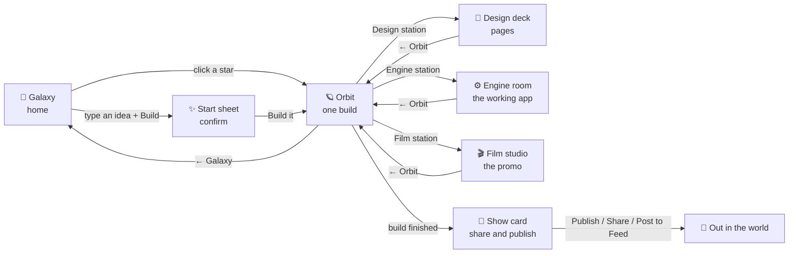

# 12 · Flow map and calm UI

Owner feedback, 2026-11-09: "so much text", "can't drag the star map", "no idea how Engine room, Film studio work",
"can't click Film studio", "need a proper flow map", "expand for more details, but by default a good GUI that is easy to use".

This spec is the map of every screen, what a person does on it, and the rules that keep each screen calm.
It replaces the text-heavy parts of specs 05, 07 and the galaxy work in #64 and #67 where they disagree.

## The flow

| Screen | What the person wants | The one main action | Shown by default | One tap away |
|---|---|---|---|---|
| Galaxy | pick a past build or start a new one | **Build** (prompt box) | galaxy, stars with names, prompt box | star details, Star chart list |
| Start sheet | say what to build, then go | **Build it** | prompt, 4 example chips, Make / Pro | the steps it will run, Games, Supabase, launch kit |
| Orbit | watch it get built, step in | open a station | sun + pages, 3 labelled stations, progress pill, one Hermia line | step list, crew log, reasoning, raw errors |
| Design deck | look at and edit the pages | open a page | the canvas | section tools |
| Engine room | use the app it built | **Open app** | live preview of the app | files, code wall, gates |
| Film studio | watch the promo | **Play** | the video | clips, captions, launch kit |
| Show card | share the result | **Share** | title, poster, link, QR | stats |

## Rules

1. **Names, not sentences.** A button, card or step shows its name. An explanation is deleted; if one is truly
   needed to decide, it goes one layer down, in the sheet you open by tapping the thing. Never in a hover.
2. **Never show raw errors.** A failed step says "⚠ Skipped: Supabase could not be set up · Details". The JSON
   or stack only appears after Details.
3. **Every clickable thing has an icon and a word** and a hit area of at least 40 × 40 px. A tooltip is only
   the 1–3 word name of an icon-only control ("Close"), never on anything that shows text.
4. **Nothing overlaps.** The Hermia bar, the progress pill and the stations each own their space; the
   stations are placed inside the free area and never under a panel or bar.
5. **Space can be moved.** Drag turns the galaxy and the orbit view, the wheel or a pinch zooms, and a
   "recentre" button brings it back. A click (no drag) still picks a star or station.
6. **Stations explain themselves.** Each one is a big icon with its name and a status word (idle, working,
   ready) under it. Nothing more, on screen or on hover.
7. **Progress is a pill, not a wall.** In the orbit view Auto shows a small pill: step n of m, the current
   step's name, the time. A click opens the full list; it closes itself when you click elsewhere.
8. **The Start sheet is short.** The prompt and chips, Make / Pro, one Build button. "What happens" (the
   steps, as an icon row) and "Options" (games, Supabase, launch kit) are folded by default. Not in the
   groundwork PR: today's Auto sheet, game wizard and Launch kit stay as they are until the new site map
   (docs/ux/SITEMAP.md) replaces them.
9. **Readable contrast.** Text on the yellow button is dark; muted text is at least 4.5:1 on its background.
10. **Every panel closes three ways:** its × button, Esc, and a click outside it. The Start sheet (today's
    Auto box) is the one the owner could not close.
11. **One sound control.** Crew voices, chatter sounds and the volume live in one button in the top bar. A
    click opens its popover: Crew sound (On / Muted / Quiet) and Volume. The M key still steps the modes. The
    button keeps one width in every mode, so nothing beside it moves. No second sound control anywhere.
12. **Desktop first, still fine when narrow.** Check 1440, 1280, 1024 and 768 wide; at 390 wide the screens
    stack, the stations become a row of buttons, and nothing scrolls sideways.
13. **UI is built from the kit; no one-off form controls.** Every button, field, checkbox, toggle, chip,
    dialog and popover uses the components below (docs/ux/RULES.md rule 13).
14. **Always a way home.** The logo goes to the galaxy from every view, Classic view included. Esc goes up one
    level (room → orbit → galaxy) when no panel is open; with a panel open, Esc closes the panel first.

## The kit

Hand-written, shadcn/ui-style, no build step: `web/ui.css` (the look) and `web/ui.js` (the behaviour). The
server inlines both into the canvas page. Everything is prefixed `ui-` so it never collides with older styles.

**Tokens** (`--ui-*` on `:root`): `background`, `foreground`, `card`, `popover`, `muted`, `muted-foreground`,
`primary` (Hermes yellow) and `primary-foreground` (dark), `secondary`, `accent`, `blue`, `destructive`,
`warning`, `success`, `border`, `input`, `ring`, `radius`, and the three fonts.

| Component | Markup |
|---|---|
| Button | `button.ui-btn` + one of `ui-btn-default` (primary, yellow), `-blue`, `-outline`, `-ghost`, `-destructive`, `-link`; sizes `-sm`, `-lg`, `-icon`. Every size keeps a 40 px hit area. |
| Card | `.ui-card` > `.ui-card-header` (`.ui-card-title`, `.ui-card-desc`), `.ui-card-content`, `.ui-card-footer` |
| Dialog | `SwarmUI.dialog({ kicker, title, body, footer, size, onClose, canClose })`: overlay, ×, Esc, outside click |
| Popover | `SwarmUI.popover(anchor, html, { className, align, above, onClose })`: under its anchor, kept on screen |
| Any panel | `SwarmUI.layer(el, close, { modal, extra, isOpen, canClose })`: joins the same × / Esc / outside rules |
| Field | `label.ui-field` > `span.ui-label` + `input.ui-input` / `textarea.ui-textarea` / `select.ui-select` |
| Checkbox | `label.ui-check` > `input.ui-checkbox` + `span` (the box sits beside its label; the label toggles it) |
| Switch | `label.ui-check` > `input.ui-switch` + `span` |
| Toggle group | `.ui-toggle-group` > `button.ui-toggle` (`.on` or `aria-checked="true"`); `ui-block` fills the width |
| Tabs | `.ui-tabs` > `button.ui-tab` |
| Chips | `.ui-chips` > `button.ui-chip` (`aria-pressed` when picked) |
| Collapsible | `details.ui-collapsible` > `summary` |
| Badge | `.ui-badge` + `-ok`, `-warn`, `-busy` |
| Progress, steps | `.ui-progress > i`, `ol.ui-steps > li.done / li.on` |
| Slider | `input.ui-slider[type=range]` (its fill follows the value) |
| Tooltip | `title="Close"` on an icon-only control, 1–3 words (plus its key, if it has one); `ui.js` shows it as the kit's tooltip after 0.5 s. Never on anything that shows text |
| Separator | `.ui-separator` |

Plain `input[type=checkbox]` and `[type=radio]` anywhere in the app are fixed to 18 px beside their label by the
kit, so an old form can't stretch one across a row again.

Explanations are deleted, not hidden. No tooltip on anything that shows text, and the number of `title=` and
`data-tip` in `web/` never goes up (106 on main on 2026-11-09, 71 after the groundwork PR). If a sentence is
truly needed to decide, it goes one layer down (docs/ux/RULES.md, rule 9).

## Done when

- Screenshots at 1280 and 768 for each screen in `docs/specs/screens/flow/`.
- A Playwright check finds no overlapping clickable boxes on Galaxy, Start sheet and Orbit at 1280, 1024 and
  768, and no horizontal scroll at 390.
- Drag turns the view, and a plain click still opens a star or station.
- Each station opens its room with a click, Film studio included.
- The Start sheet closes with ×, Esc and an outside click; its prompt box is fully visible and the launch-kit
  checkbox sits next to its own label.
- From every view the logo lands on the galaxy, and Esc climbs room → orbit → galaxy.
- No title or data-tip on anything that shows text, on every screen the check visits, and no more of them in
  `web/` than on origin/main.
- The crew button opens the sound popover and keeps its size and place in every mode.
- `node scripts/ui-check.mjs` checks all of the above against a test server; `node scripts/ui-review.mjs` runs
  the studio's own design review (`engine/review.mjs`'s prompt, for an app screen) on each screen.
