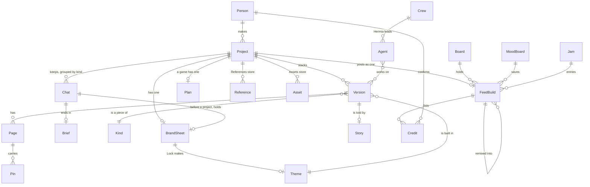

# Objects and names

Every object a person meets in Swarm, what it holds, what it belongs to, where it shows, and the one name it goes
by in code, copy and docs. This is the first of the six design artifacts in [PLANS.md](../PLANS.md) §5: the
statechart, breadboards, per-screen specs and mock-ups that come after it use these names.

Status: **draft for the owner to review** (2026-11-13). Each name is marked the way PLANS.md marks its lines:

- **Decided:** the owner already said it, with the date and where.
- **Proposed:** this page's pick. Nothing gets renamed until the owner says so.
- **Open:** two names are in use and neither has been picked.

Read it with [PRODUCT.md](../PRODUCT.md), [RULES.md](RULES.md), [SITEMAP.md](SITEMAP.md) and
[INVENTORY.md](INVENTORY.md). Where they disagree with each other, the disagreement is listed in
[Where the names differ](#where-the-names-differ), not settled here. Update this page when you add an object or a
name.

## The map

The core objects and how they hang together. Smaller objects (a palette, a section, a jam entry) are in the
sections below.

Left of the line from Project to FeedBuild is the Studio, on the person's own machine. Right of it is the Feed, the
one hosted part ([decision 0001](../decisions/0001-studio-is-local-feed-is-hosted.md)).

## The two homes

| Object | Canonical name | What it is | Status |
|---|---|---|---|
| The hosted social app | **Feed** (Swarm Feed) | Home, Discover, Me and the social side. Opens from `/swarm` in Hermes and at swarm.design-bakery.com | Decided (PRODUCT.md, 0001) |
| The local plugin | **Studio** (Swarm Studio) | Everything that makes things: Projects, a project, its rooms. Runs on the person's machine | Decided (PRODUCT.md) |
| The Feed's first tab | **Home** | One Feed build per screen, swiped (SITEMAP §3) | Decided (SITEMAP, owner 2026-11-09) |
| The Studio's file browser | **Projects** | Recent, All projects, Chats, Assets, Trash, folders (SITEMAP §6, `web/home.js`, `server/projects.mjs`) | Decided (PATTERNS.md) |

"Studio" also names three smaller things, and "Home" names Projects in code. See the table at the end.

## Studio objects

### Project

- **What it is.** One idea, with every version of it stacked on one card. "One idea is one project with one name,
  everywhere" ([spec 18](../specs/18-projects.md)).
- **Attributes.** `id` (pid), `name` (from `engine/naming.mjs`, never a page title), `title`, `folder`, `trashed`,
  `made`, `runs: [id]`, `studio?` (`server/projects.mjs:7`); pieces, one per kind, each its newest version.
- **Relations.** Has versions, chats (grouped Design, App, Game, Video), one brand sheet (`projects/<pid>/brand.json`),
  a References store, an Assets store, one Feed build once posted.
- **Shows on.** Projects (a card: picture, title, kind icons), the Overview, the top bar's breadcrumb
  (`Projects › name ▾`), the Design deck's title, the Feed (as one Feed build).
- **Name.** **Project**. Decided (spec 18; owner 2026-11-11, REQUIREMENTS "Chats apart from projects").

### Version

- **What it is.** One build of a project's piece. A re-run of the same kind is that piece's next version.
- **Attributes.** `id`, kind (piece), title, cover, theme, live link, `story.json`, `launch.json`, its files in
  `runs/<id>/`.
- **Relations.** Belongs to one project and one kind. Has pages (a site or app), a game, a film; a story; a launch kit.
- **Shows on.** Projects (a stack: `Version 3, 2, 1`, `web/home.js:204`), the breadcrumb's ▾ menu
  (`web/project.js:1155`), Versions (compare, restore; SITEMAP §9).
- **Name.** **Version** in copy and docs. Decided (owner 2026-11-12, REQUIREMENTS "Nothing builds until the person
  says so": "Version 3, 2, 1, not projects of their own"). The code calls it a **run** (`runs/`, `nav.js` context
  `run` and `version`, `/api/runs`) and spec 18 calls it a **piece** when it means its kind. Proposed: **version**
  everywhere new; `run` stays the storage word for a version's folder and id until a rename is approved.

### Kind and piece

- **What it is.** What a project makes. The kind menu offers Website, App, Game, Video, Brand, Deck
  (`web/home.js:673-679`). A project's **piece** is its part of one kind (spec 18: `site`, `app`, `game`, `film`).
- **Shows on.** The kind menu in Projects, the card's kind icons, the Overview's sections, the mode menu.
- **Name.** Open. The same kind has two names in copy: **Website** in the kind menu but **Site** on the Overview's
  section (`web/project.js:20`) and in SITEMAP §5; **Video** in the kind menu and mode menu but **Film** on the
  Overview's section and in the engine (`piece: film`, `engine/director.mjs`, the Film studio). Proposed: the kind
  menu's words (Website, App, Game, Video) in copy; the short ids (`site`, `app`, `game`, `film`) stay ids.

### Lens

- **What it is.** Which tools and which first room a build gets: Just make it, Design, Develop, Game, Mix, Launch
  ([AUDIENCE.md](AUDIENCE.md)). Guessed from the idea, shown as a chip.
- **Name.** **Lens**. Decided (owner 2026-11-09, AUDIENCE.md). Not the same as a kind: a kind is what is made, a
  lens is who is making it. The chip in code today picks a kind; no lens chip ships yet (not checked beyond
  `web/home.js`).

### Chat

- **What it is.** A conversation with the planner. A loose chat is not a project and is never listed in Projects;
  once it builds, it moves into the project ([spec 29](../specs/29-chats-references-marks.md)).
- **Attributes.** `id`, turns, decisions, spec, state, lead (written by `engine/talkplan.mjs`), `brand` (the brand
  sheet before there is a project), category (Design, App, Game, Video) once in a project (`engine/chats.mjs`).
- **Relations.** Belongs to no project, or to one. Ends in a brief. Can hold a brand sheet.
- **Shows on.** Projects › Chats (New chat heads the list), the Design deck's chat, the brand sheet's breadcrumb
  (`Chat › Brand sheet`).
- **Name.** **Chat**. Decided (owner 2026-11-11, REQUIREMENTS "Chats apart from projects"). Code also says
  **talk** (`web/canvas/talk.js`, `engine/talk.mjs`, `engine/talkplan.mjs`, `server/talk.mjs`, "talk first"), and
  nav.js calls a project talked through with nothing built a **draft** (`web/nav.js:9`). On the Feed, **Talk** is
  the right-rail button for notes on a build (SITEMAP §3), which is a different object (a pin). Proposed: **chat**
  for the object; "talk first" may stay as the action's copy.

### Brief

- **What it is.** The plan in plain words that a chat ends in: what will be built and the steps. The person reads
  and edits it, then presses Build or Keep talking.
- **Name.** **Brief**. Decided (owner 2026-11-11, REQUIREMENTS "Talk before building"; decision 0004).

### Brand sheet

- **What it is.** Before a website or app is designed: the story, palettes, type pairings, and optionally voice,
  pictures and a storyboard, side by side. Lock makes the picks the build's theme
  ([spec 31](../specs/31-brand-sheet.md), `engine/brand.mjs`).
- **Attributes.** Story (what, who, pages); options per part: **palette** (each with light and dark samples),
  **type** (heading and body fonts), **voice**, **pictures**, **storyboard** (one rough frame per kind of page);
  the person's own words as one more option; `locked`.
- **Relations.** Lives on a chat (`chat.brand`) before a project exists, then on the project
  (`projects/<pid>/brand.json`, `engine/studio.mjs`). Filled from a **brand pack**. Lock makes one theme.
- **Shows on.** The brief's **Brand sheet** button (`web/canvas/talk.js:158`), the Projects way picker
  (`web/home.js:747`), the Studio scaffold's Brand card (`web/scaffold.js:115`), the sheet itself (`web/brand.js`).
- **Name.** **Brand sheet**. Decided (owner 2026-11-12, REQUIREMENTS "A brand sheet before the first page").
  Also called the **brand board** (`web/home.js:746` comment), the **brand card** and **Brand** step (SITEMAP §5c,
  `web/scaffold.js:121`), and, in the guided-walk prototype, the **moodboard** (PLANS §1: "the brand options are the
  moodboard"). The Feed's **mood board** is a different object.

### Brand pack

- **What it is.** A ready-made set for the brand sheet: a picture style with samples, a palette, type and corners, a
  voice, a storyboard (`engine/brandpacks.mjs`). Its slug has the Feed's pack form.
- **Name.** Open. PLANS §1 (guided walk) says "People never see the word pack", yet the brand sheet on main shows a
  **Packs** section (`web/brand.js:109`). Five things are called a pack; see the table at the end.

### Theme

- **What it is.** What Lock freezes from the brand sheet: `--background`, `--foreground`, `--primary`, `--accent`,
  `--link`, the heading and body fonts, the corner radius (`brandTheme`, PLANS §1). Builds use only these, and the
  reviewer's `checkBrand` flags anything off them.
- **Shows on.** The Design deck's right panel with nothing selected ("page and variables"), Fill › Token (SITEMAP
  §10).
- **Name.** Proposed: **theme** for the locked set (what `engine/brand.mjs` and the server already return), and
  **variable** for one entry, as Figma says. PLANS §1 calls them "Lock's variables", SITEMAP §10 "Token (a
  variable)", PLANS §5 "design tokens". Keep **token** for the plugin's own UI colours (`--accent` in
  `web/canvas.css`, RULES standing rule 3), which are not the build's. The ☰ Light / Dark choice is the
  **appearance**, not a theme.

### Lock

- **What it is.** The press that freezes a choice before anything costs: the brand sheet's look, a game's plan, the
  Studio's idea (SITEMAP §5c).
- **Name.** **Lock**. Decided (spec 21, spec 31). Not the release **pin** of decision 0008.

### Plan (the game's Plan board)

- **What it is.** A game's nine cards, its starter (engine, template, art), its systems, sketches, mocks and world,
  locked at a shown price before the build ([spec 21](../specs/21-plan-before-spend.md), `web/plan.js`).
- **Attributes.** `id` (`p-…`), cards, `starter: { engine, template, assets, systems }` (`engine/starters.mjs`),
  `price`, `gate`.
- **Relations.** One per game project. Can be saved as a **template** and remixed (`engine/template.mjs`).
- **Shows on.** The Plan board (`Projects › name ▾`; the name falls back to **Plan**, `web/plan.js:105`), Projects
  (a plan joins its project's card: "Open the plan").
- **Name.** **Plan**, on the **Plan board**. Decided (spec 21). "Plan" also names the planner's talk
  (`engine/talkplan.mjs`), a Studio step (`STEPS`, `web/nav.js:22`), the guided walk's pages-and-sections step (PLANS
  §1) and the Progress ring's first phase (SITEMAP §9). The price is shown in **credits** (`web/plan.js:145`,
  "Lock · 324 credits"), the word decision 0001 retired for builds; see the table at the end.

### Studio scaffold (Studio first)

- **What it is.** A project's steps before its first build: Brand, References, Assets, Plan, Proposal
  ([spec 37](../specs/37-studio-first.md), `web/scaffold.js`, `engine/studio.mjs`).
- **Attributes.** `studio.json`: `kind`, `idea`, `depth` (Light, Thorough), `chat`, `steps`, `start`, `kit`,
  `proposal`, `locked`.
- **Name.** Open. Copy says **Studio** (`web/home.js:745`, `web/scaffold.js:121`) and **Studio first** (SITEMAP §6);
  nav.js says `studio`. "Studio" is already the whole plugin. Proposed: **Studio first** for the choice and the
  scaffold, so the bare word keeps meaning the plugin.

### Kit

- **What it is.** One kind's tools in the Studio scaffold: `web/kit-site.js`, `kit-app.js`, `kit-game.js`,
  `kit-video.js`, `kit-brand.js`, `kit-deck.js`.
- **Name.** **Kit** (PLANS §3, §4: the Video kit, the Deck kit). Also used for the **launch kit** (posts) and, in
  RULES rule 13, for the shadcn components ("Build from the kit"). Proposed: **kit** for a kind's kit; **the
  component kit** in RULES; **launch kit** stays as the full name.

### Reference and Asset

- **Reference.** "Like this": a picture, clip, file or link the crew reads but doesn't use as given.
  `refs/index.json`: `id, kind, name, file, url, use, source, removed` (`engine/refs.mjs`). Shows in the Studio
  scaffold's References step and the Overview's **References** section.
- **Asset.** "Use this as given": a logo, product photos, a starter pack. `assets/index.json`: `id, kind, name,
  file, role, source, removed` (`engine/assetstore.mjs`). Shows in the Assets step, Projects › Assets.
- **Name.** **Reference** and **Asset**. Decided (spec 29, spec 37). `engine/assets.mjs` is "something else: a
  build's own pictures" (`engine/assetstore.mjs:4`); on the Overview those are **Art** and **Uploads**. On the Feed
  a build's **assets** are anything it shows (pages, sprites, clips, palette). Proposed: name a build's own
  pictures **art** in new code.

### Page, section, element, layer

- **Page.** One page or screen of a site or app; an artboard on the Overview, a page in the Design deck's left
  panel.
- **Section.** A band of a page (hero, menu). The crew builds by section.
- **Element.** One thing inside a section; what the Design tab edits.
- **Layer.** A section or element as listed in the Layers panel.
- **Name.** All Decided by use (SITEMAP §8, §10; PATTERNS "The Design deck follows Figma"). A page title is never a
  project name (spec 18).

### Pin, mark, comment

- **Pin.** A note on a spot: yours, the crew's reply, or one of the Critic's issues (3 at most). In the Design deck
  (Comment tool), on a board (idea pin), on a Feed build (Talk).
- **Mark.** A Scribble stroke, box or ring on a page, pointing at the element under it
  (`engine/marks.mjs`: `id, kind, page, box, pts, note, target`). Draw replaces Scribble (decision 0010).
- **Name.** **Pin** for a note on a spot. Decided ("One pin everywhere", PATTERNS social sheet). **Mark** for a
  drawn mark. Copy says **Comment** for the tool. "Pin" also names pinned builds on a profile and the release pin
  (0008).

### The rooms

A project has one Overview and up to five rooms.

| Room | What happens | Code route (`web/nav.js`) | Mode menu (`web/studio.js:317`) | Status |
|---|---|---|---|---|
| **Overview** | The project's pages and files, as artboards in sections (`web/project.js`) | `overview` | Overview | Decided (owner 2026-11-11) |
| **Design deck** | The crew watched at work; a page designed, Figma's layout (`web/canvas/`) | `deck` | **Canvas** | Decided (owner 2026-11-11, AGENTS.md) |
| **Engine room** | An app's files, checks, deploy, data | `app` | **App** | Agreed direction (SITEMAP §10) |
| **Game room** | Play, Tweak, Details | `game` | Game | Agreed direction (SITEMAP §10) |
| **Film studio** | Watch, New cut, Shots | `video` | **Video** | Agreed direction (SITEMAP §10) |
| **Launch pad** | Site, promo video, posts | none yet | none | Agreed direction (SITEMAP §10) |

The Design deck reading **Canvas** in the mode menu is the owner's choice. The Engine room reading App and the Film
studio reading Video are not; they are flagged below.

### Crew and agent

- **Crew.** The agents working on a build, led by **Hermia**, the commander (SITEMAP §11).
- **Agent.** One of them. It has a **role** (Designer, Critic, Fixer, painter, coder; the lead and helpers in the
  app engine, `engine/radio.mjs`) and a **name** from one list shared by the engine and the UI (Pip, Mochi, Lumi…,
  `web/crew.js:10`, `engine/run.mjs AGENT_NAMES`). Its mark is its first letter on its shade.
- **Shows on.** Crew cursors and avatars (Design deck), the crew radio, credits on a Feed build (people and agents).
- **Model role.** What the agent runs on: Hermes's three slots `swarm_studio_planner`, `swarm_studio_builder`,
  `swarm_studio_reviewer` ([docs/engines/hermes-and-connections.md](../engines/hermes-and-connections.md)). The
  bridge names the middle one **worker** (`engine/hermesllm.mjs:21`). Proposed: **builder**, as Hermes shows it.
- **Name.** **Crew**, **agent**, **Hermia**. Decided (RULES rule 24). "Minions" in RULES rule 24 is an older word
  for agents.

### Progress and Stop

- **Progress.** One pill or ring that opens into phases (Plan, Make, Ship), then tracks, agents and what each did.
  Copy and docs call it the **progress ring** (SITEMAP §9), **progress pill** (PATTERNS), **work chip**
  (REQUIREMENTS 2026-11-11) and **progress chip** (SITEMAP §10). Proposed: **progress pill**, the name of the
  pattern it follows (Apple Maps' ETA pill).
- **Stop.** One Stop beside it, the same place everywhere; stops every build of the project on screen; the build
  ends `run:stopped` and offers **Resume**. Decided (owner 2026-11-11).

### Story, film, launch kit, live link

- **Story.** A build told in five to eight beats (`runs/<id>/story.json`: `beats: [{ role, headline, line,
  picture, seconds, say }]`, `engine/story.mjs`). Read by Story cards, the Overview's Story lane, Post to Feed, the
  launch kit and the Story film. Decided ([spec 39](../specs/39-story.md)).
- **Film.** A video a build makes: demo, mood, character, gameplay, music, announce (PLANS §3). Made with the
  **Video kit**, in the **Film studio**. See Kind for Video vs Film.
- **Launch kit.** Posts for every network, written from the build's own facts (`runs/<id>/launch.json`,
  `engine/launch.mjs`). Swarm never posts; the person presses Post on the network's own page (decision 0005).
- **Live link.** A version's public address once published (Publish › Website, Working app, Arcade).
- **Post.** On the Studio side, one network post in the launch kit. On the Feed, see Feed build.

### Connections, keys, models

- **Connection.** An outside service the person links through Hermes (Supabase, GitHub, the Feed account), with a
  state and its "Goes to" line (SITEMAP §7). How each connects is in
  [docs/engines/hermes-and-connections.md](../engines/hermes-and-connections.md).
- **Key.** A secret the plugin declares and reads through Hermes's secret scope (same page, `launcher.py:80-85`).
- **Model.** The model a role runs on, picked in Me › Settings › Models or in Hermes's model picker.
- **Name.** All three Decided by use (SITEMAP §7, spec 25).

### Pro pack

- **What it is.** A pack that turns Auto into a tool for one market: `packs/<id>/pack.json` plus tool modules that
  write real files (`engine/packs.mjs`, spec 09).
- **Name.** Code says **pack**. Proposed: **Pro pack** in full whenever it is meant.

## Feed objects

These live in Swarm Feed (`pukujan-lab-2/swarm-feed`, built on Kresilo's code). The plugin's only client is
`feed.py`. Their data model is the Feed's `docs/data-model.md`, not checked from here.

| Object | What it is | Shows on | Name and status |
|---|---|---|---|
| **Feed build** | What a project becomes on the Feed: one per project; each later version sends its **piece** into it (`feed.py:22-25`, spec 18 "The Feed contract") | Home (full screen), Discover search, a profile's showcase, boards | Open: the Feed calls it a **build**, `/swarm post` and the button call the act **Post to Feed**, and spec 18 says "one idea is one Feed post". Proposed: **build** on the Feed (what Home shows), **post** only as the verb |
| **Maker** | The person behind a build: profile, showcase, credits, story clips, followers | Home's right rail, Discover › Makers, Me | Decided (SITEMAP §3, §4) |
| **Remix** | A new build started from a Feed build's prompt; the chain is kept | Home's main button, the build's story | Decided (SITEMAP §3). The game Plan board's template "Remix" (`engine/template.mjs`) is a different act |
| **Credit** | A person or agent named on a build, with how each part was made; each person confirms their own | The build's story, profiles, Me › Notifications | Decided (PATTERNS social sheet). Not the old build **credits** (0001) |
| **Board** | A hosted board of builds and assets: cover, wanted roles, people, idea pins, activity; Private, Public or Open | Projects › Boards, Discover › Open boards | Decided (PATTERNS social sheet). Listed under **Projects** although it is a Feed object |
| **Idea pin** | A pin on a board's spot: reply, accept, decline, Build it | A board | Decided. See Pin |
| **Mood board** | A saved collection of builds, assets, clips and palettes; can start a build | Projects › Mood boards, Share › Save | Decided. Not the brand sheet's "moodboard" |
| **Jam** | A competition: theme, up to 6 rules, open and close dates, entries, votes, winners | Discover › Jams and events | Decided |
| **Entry** | A build posted into a jam | A jam | Decided |
| **Event** | A live build session or meetup; Going sets a reminder | Discover › Jams and events, Home › Live | Decided |
| **Notification** | A join request, a credit to confirm, a suggested change | Me › Notifications | Decided |

## Where the names differ

Every place the code, the copy or the docs name one object two ways. Nothing here is renamed by this page; each row
is a follow-up for the owner to settle.

### The breadcrumb

| Where | What it shows |
|---|---|
| RULES.md rule 7 | `Home › Projects › build › room` |
| SITEMAP §8 | `Projects › project ▾`, then Back from a room |
| A project (`web/project.js:82`) | `Projects › name ▾` |
| The Plan board (`web/plan.js:23`) | `Projects › name ▾`, the name falling back to `Plan` (`:105`) |
| The Studio scaffold (`web/scaffold.js:29`) | `Projects › name` (no ▾) |
| The brand sheet (`web/brand.js:21`, `:200`) | `Chat › Brand sheet`, or `Studio › Brand sheet` when opened from a project |
| The guided game maker (`web/workshop.js:153`) | `title › step` |
| A room | Back, reading `Overview` or `Projects` (`web/studio.js:191`) |

RULES and SITEMAP disagree with each other (RULES starts at the Feed's Home and says "build", SITEMAP starts at
Projects and says "project"). The brand sheet's crumb names neither Projects nor the project. Proposed:
`Projects › project ▾ › room`, the room's name in place of Back, with the logo going Home (rule 7's other half).

### The rooms

| Object | Docs | Mode menu | Code route |
|---|---|---|---|
| The crew's design room | Design deck | Canvas (owner's choice) | `deck`; the menu's own value is `canvas` (`web/studio.js:317`) |
| The app room | Engine room | App | `app` |
| The film room | Film studio | Video | `video` |
| Projects | Projects, "Studio home" (REQUIREMENTS 2026-11-12), "the galaxy" (AUDIENCE.md) | — | `home` (`web/nav.js:8`) |

"Canvas" for the Overview is against the owner's rule (AGENTS.md: "Never call the Overview a canvas"). It is still
written in `server/board.mjs:1` ("A project's canvas"), SITEMAP §5 ("Canvas: Site", "Open its canvas") and §6
("Open → its canvas"), §13 ("Its canvas"), and AUDIENCE.md and INVENTORY.md's galaxy, orbit and stations, which
describe the star-map Projects that the file browser replaced.

### One word, several objects

| Word | The objects it names | Proposed |
|---|---|---|
| **build** | A version (Studio); the act and its button; a Feed build; nav.js's state for an open version (`web/nav.js:13`); "a build" on Home | The verb and button; **Feed build** on the Feed; **version** in the Studio |
| **run** | A version's folder and id (`runs/<id>`); Auto's automatic run; a play-test run | Storage word only |
| **board** | The Plan board; the "brand board" (`web/home.js:746`); `web/board.js`, the shell both share; `server/board.mjs`, the Overview's data; Feed boards; open boards; mood boards; a storyboard | **Plan board**, **board** (Feed), **mood board**; rename the brand board to brand sheet and `server/board.mjs`'s comment to the Overview |
| **pack** | Brand packs (`engine/brandpacks.mjs`); Pro packs (`engine/packs.mjs`); the art library's style packs (`engine/library.mjs`); a game starter's art pack (PLANS §2); Discover › Packs (SITEMAP §4, the Feed's `swarm.packs`); a starter pack as an asset | Owner's call; at least never "pack" alone in copy |
| **kit** | A kind's kit (`web/kit-*.js`); the Video and Deck kits; the launch kit; the shadcn components (RULES rule 13) | See Kit |
| **plan** | The game's Plan board; the planner's talk (`engine/talkplan.mjs`); a Studio step; the guided walk's Plan step; Progress's first phase | **Plan** for the game's plan only |
| **talk** | A chat with the planner (code); the Feed's right-rail Talk (pins) | **Chat** for the first |
| **Studio** | The plugin; the scaffold (`web/home.js:745`, `web/scaffold.js:121`); "Studio home" = Projects; the brand sheet's crumb; the **hosted studio** (SITEMAP §1, `web/canvas/hosted.js`, `server/hosted.mjs`), which decision 0001 retired | The plugin only |
| **Home** | The Feed's first tab (docs); Projects (`web/nav.js:8`, `C.go('home')`) | The Feed's tab only |
| **theme** | The locked look (`brandTheme`); Light / Dark; the old theme toggle (PATTERNS) | See Theme |
| **variable / token** | One locked look value (SITEMAP §10); the plugin's UI colours (`--accent`); W3C design tokens (PLANS §5) | Variable for the build, token for the plugin |
| **credits** | The Plan board's price (`web/plan.js:4`, `:145`; SITEMAP §5, §5b; the `/api/plans` check in `scripts/check.sh`); the Feed's credits to people; "build credits" retired by 0001 | Owner's call: the Plan board's price is a model-cost estimate on the person's own keys, and "credits" reads as something bought from us |
| **lock** | Brand Lock; Plan Lock; the Studio's idea Lock; the release pin (0008) | Lock for the first three |
| **pin** | A note on a spot; a pinned build on a profile; the release pin | Pin for a note on a spot |
| **template** | A game starter's template (`engine/starters.mjs`); a saved plan (`engine/template.mjs`); Open Design's templates | Starter template; saved plan |
| **review** | The Critic's review; ☰ Review on the Overview; `scripts/ui-review.mjs`; the independent review in PLANS §5 | Fine as is: each is said in full |
| **Make** | The kind menu's entry (SITEMAP §5c, §6, "Make › Studio first") alongside **+ Create**, "the one way to start a build" (RULES rule 1) | Owner's call: two names for starting |
| **Delete / Trash** | A project's menu reads Delete and moves it to Trash (`web/home.js:480`); SITEMAP §6 says Trash | Move to Trash, as SITEMAP says |

### Smaller mismatches

- **Website / Site** and **Video / Film** for the same kind (see Kind).
- **worker / builder** for the middle model role (see Crew and agent).
- `engine/story.mjs:1` cites `docs/specs/37-story.md`, which doesn't exist; the story spec is
  [39-story.md](../specs/39-story.md).
- RULES.md rule 24's **minions** are the agents.

## Glossary

One line each, the canonical name first. **Bold** names are Decided; *italic* are Proposed.

| Name | Means | Not to be confused with |
|---|---|---|
| **Agent** | One member of the crew, with a role and a name | A model role |
| **Asset** | A file the crew uses as given (Assets store) | A build's own *art*; a Feed build's assets |
| **Board** | A Feed board of builds, people and pins | Plan board, mood board |
| **Brand sheet** | Story, palettes, type, voice, pictures, storyboard before a build | Mood board |
| **Brief** | The plan in plain words a chat ends in, read before Build | Plan |
| **Chat** | A conversation with the planner | Talk (Feed) |
| **Crew** | The agents on a build, led by Hermia | — |
| **Credit** | A person or agent named on a Feed build | Plan-board price |
| **Design deck** | The crew's design room; Canvas in the mode menu | Overview |
| **Engine room** | The app's files, checks, deploy, data | App (kind) |
| **Feed** | The hosted social app | Studio |
| *Feed build* | A project on the Feed | Version |
| **Film studio** | The film's room | Video kit |
| **Hermia** | The commander | — |
| **Home** | The Feed's first tab | Projects |
| **Kind** | Website, App, Game, Video, Brand, Deck | Lens |
| **Lens** | Who is making it: the tools and the first room | Kind |
| **Lock** | Freezing a choice before it costs | Release pin |
| **Mark** | A drawn stroke on a page | Pin |
| **Mood board** | A saved Feed collection | Brand sheet |
| **Overview** | A project's pages and files | Design deck |
| **Page** | One page or screen of a site or app | Project name |
| **Pin** | A note on a spot | Mark |
| **Plan** | A game's cards, starter and systems, on the Plan board | Brief |
| *Progress pill* | The one progress display | — |
| **Project** | One idea and all its versions | Version |
| **Projects** | The Studio's file browser | Home |
| **Reference** | A file the crew reads as "like this" | Asset |
| **Remix** | A new build from a Feed build | Plan template |
| **Story** | A build in five to eight beats | Maker's story clips |
| **Studio** | The local plugin | *Studio first* |
| *Theme* | The locked look | Appearance (Light / Dark) |
| *Variable* | One value of the theme | Token |
| **Version** | One build of a project's piece | Run (storage) |
