# Site maps and flows

Every screen of Swarm as one tree. Hermes opens the **Feed**, the way Kresilo opens on its home feed; the Studio
is inside it, reached through **+ Create** (a new build) or **Projects** (your builds). The Feed works like
TikTok: one build per screen, swipe for the next, and the build's own visuals and assets do the talking.

Each layer shows 2–4 choices, and the tree goes as deep as it needs to: the deepest paths are 14 layers (see
[RULES.md](RULES.md) rule 2). A dotted line jumps to another branch. Update this file when you add a layer or
move a branch.

Status: **agreed direction** (owner, 2026-11-09). Lens names follow [AUDIENCE.md](AUDIENCE.md).

## 1. The whole product

The same Feed opens from Hermes (with + Create and your Projects) and on the web at swarm.design-bakery.com
(where Remix and + Create hand off to Hermes). The web also has a **hosted studio** at `/studio/app`: a guest
tries a small build with no install, a few a day, then is pointed to the plugin (spec 13).

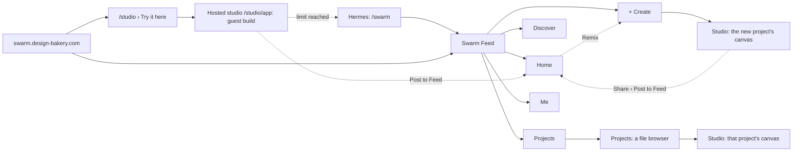

## 2. Navigation

Five slots, always in the same place: a bottom bar on a phone, a left rail on a desktop. Four places and one
primary action, + Create, in the middle.

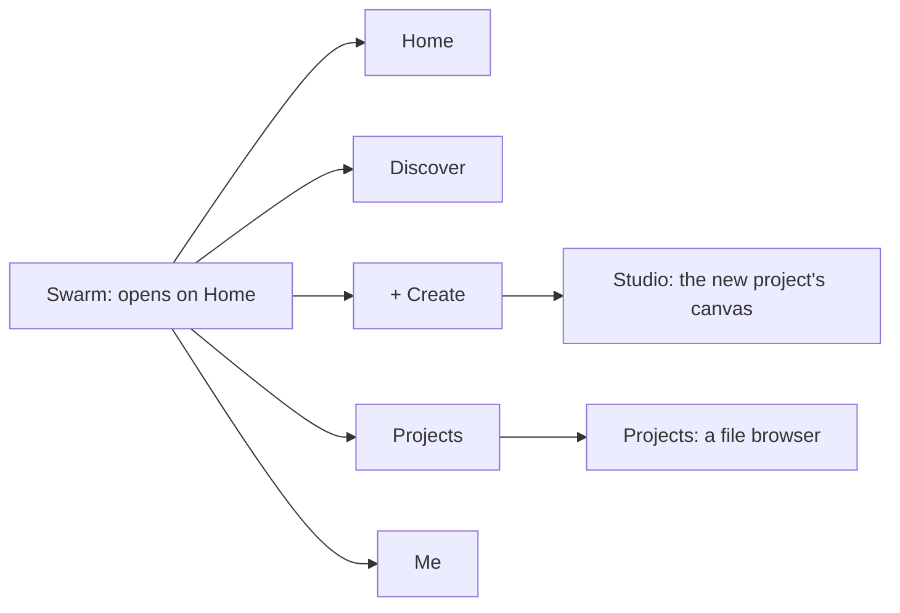

## 3. Home

One build fills the screen and plays itself (a game demo, a site scrolling, a film clip). The only text is the
maker and the title. No descriptions: the assets and the story are pictures and clips.

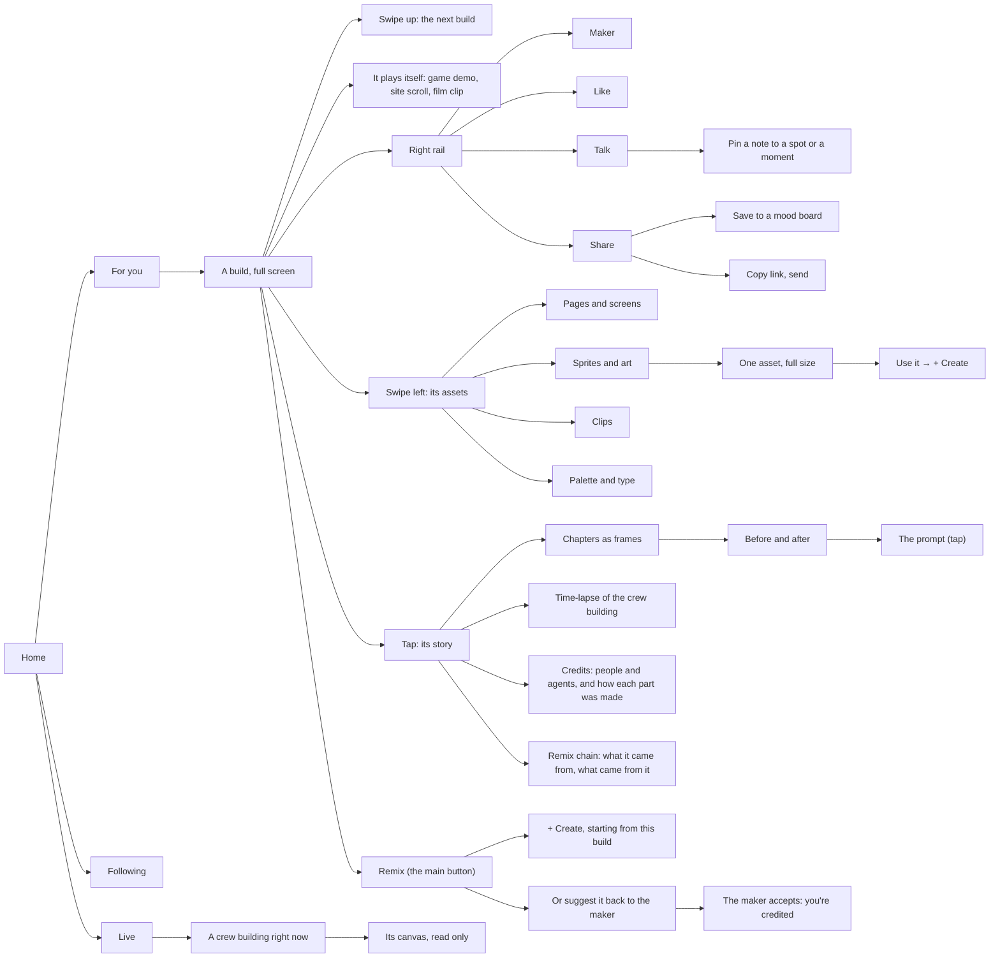

## 4. Discover

The social side (open boards, jams, events, makers) is mostly Kresilo's code, already in Swarm Feed, moved into
this tree. What each piece borrows, and from where, is in [PATTERNS.md](PATTERNS.md).

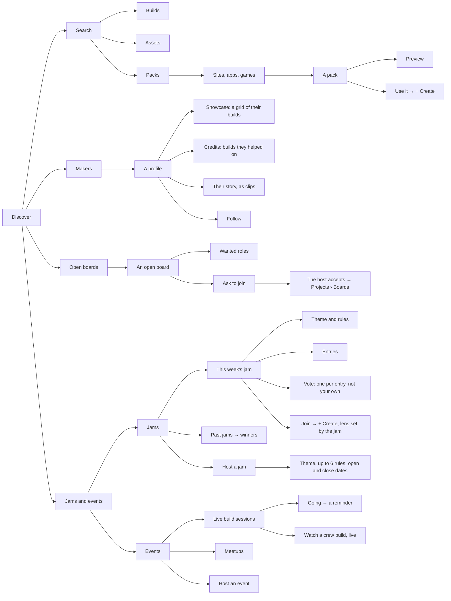

## 5. + Create

The one way to start a build. Hermia sits beside the input; the input becomes the chat inside the build.

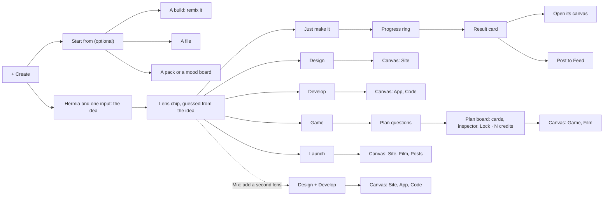

## 5b. The Plan board (spec 21)

A Game opens here after its questions. Nothing that costs credits runs before the lock.

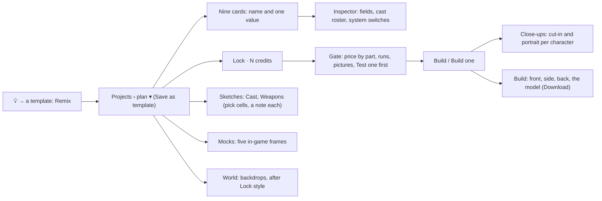

## 6. Projects

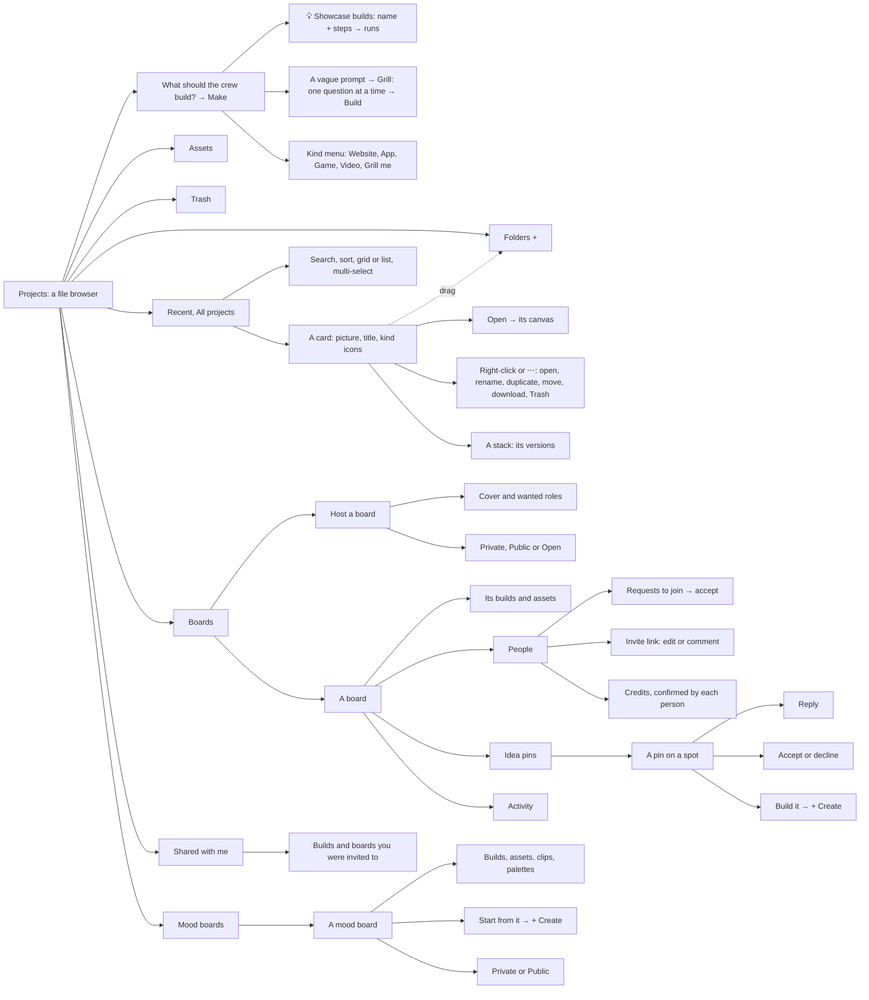

## 7. Me

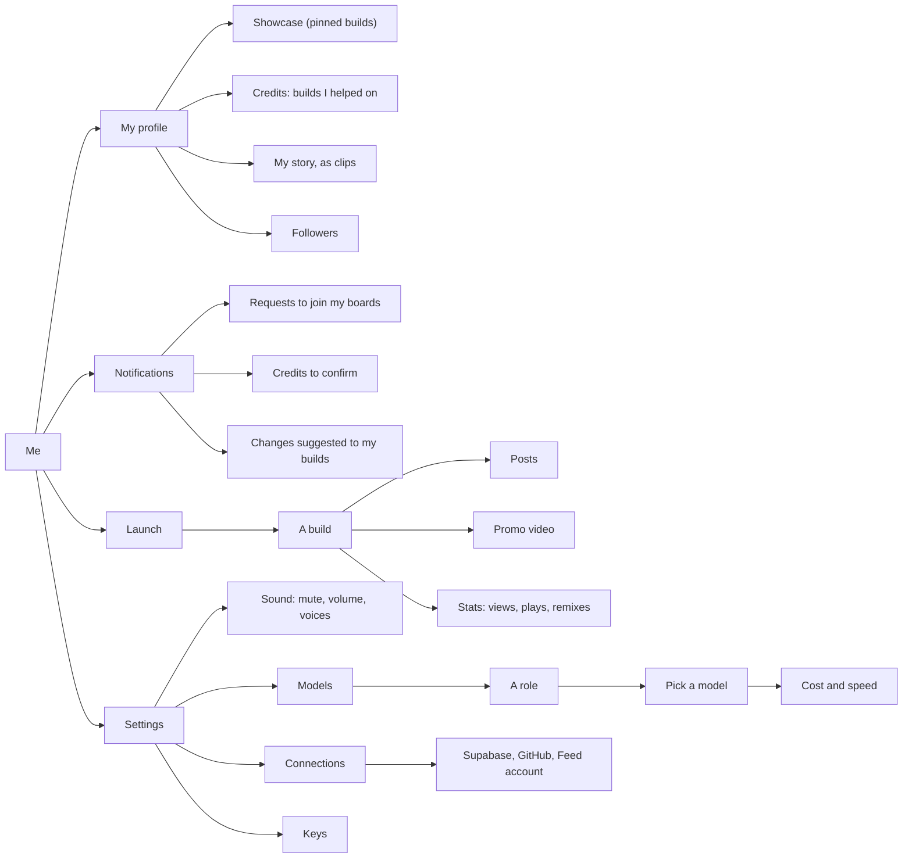

## 8. A project: one canvas

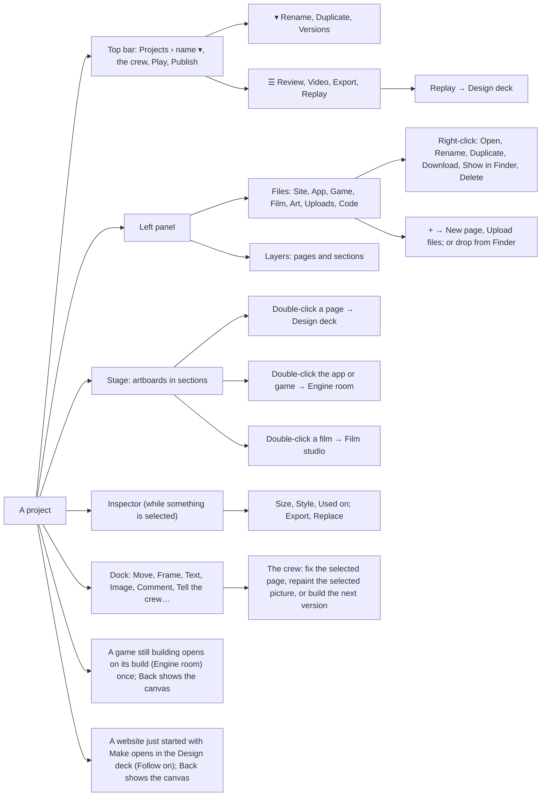

The way home is always there and is not a branch: the breadcrumb (`Projects › project ▾`, then Back from a room), the
logo (back to Home) and Esc.

## 9. Progress, versions, share

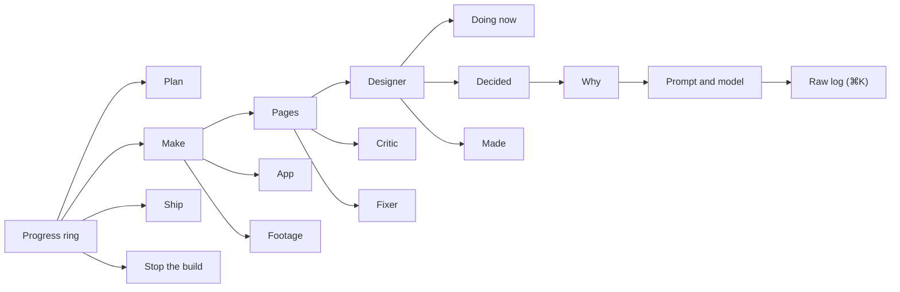

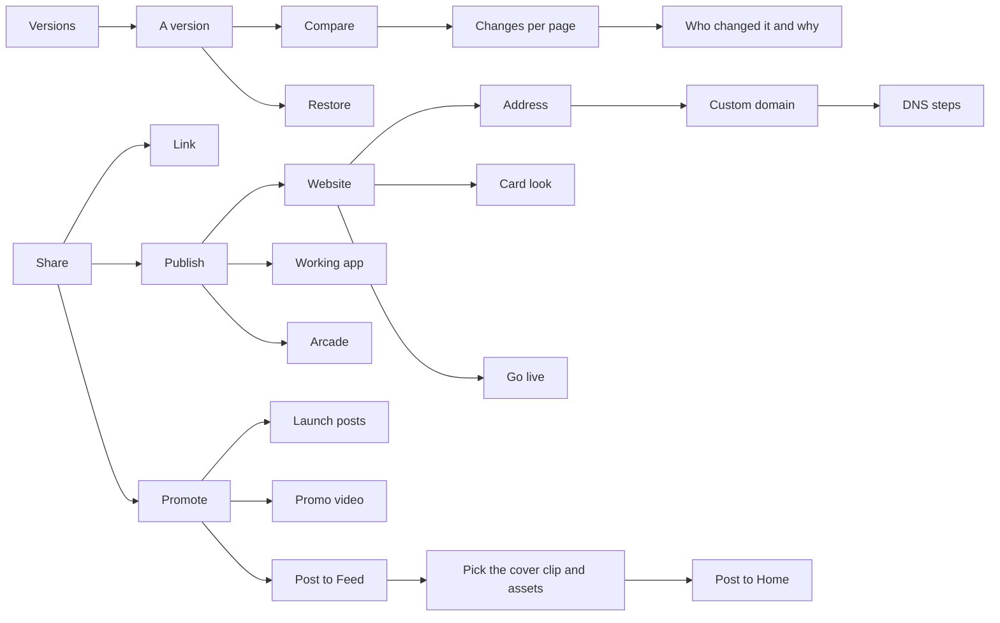

## 10. The rooms

### Design deck

The one room with a full toolset. It follows Figma's layout and tools almost one to one (see
[PATTERNS.md](PATTERNS.md)): two panels, the canvas and one toolbar. The panels are zones, not layers.

It is also the one room where the crew can be watched at work, so a website started with Make on Projects opens
here, with the Follow camera on and the progress chip in view (owner, 2026-11-11: a build finished before anyone
had opened a page). Back goes to the project's canvas. A page double-clicked on that canvas opens here too.

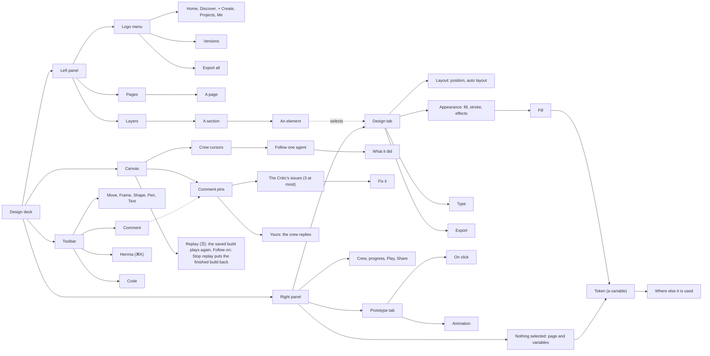

### Engine room

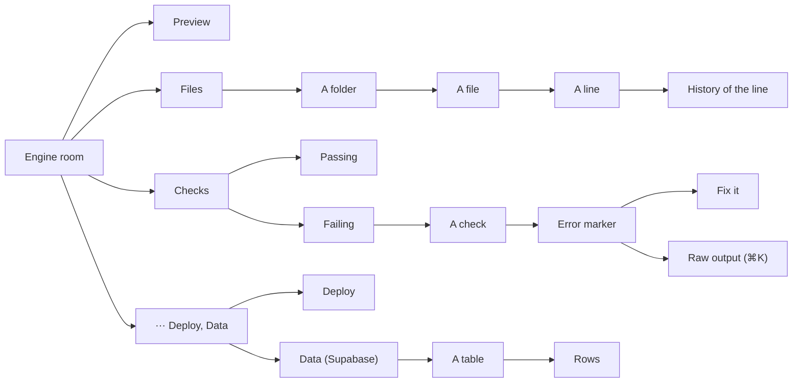

### Game room

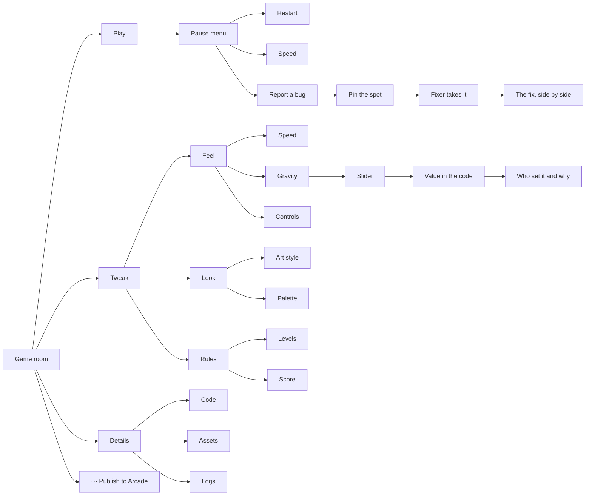

The 7-step game wizard is gone. Its questions become the Tweak branch, asked after the first playable build.

A game build's wall follows what the crew is doing: three painters and one code tile while the art is painted, four code tiles after. When the build stops:

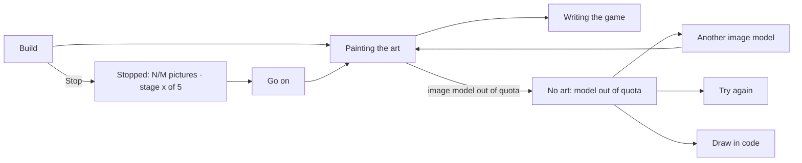

### Film studio and Launch pad

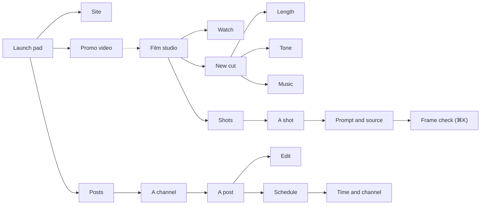

## 11. Hermia, the commander

Hermia leads the crew. She is our own character: the owner's reference was an ink-style anime portrait, and we
take the look (bold black ink on white, flat, one accent colour, a cyber headset), not that character, per the
original-content rule.

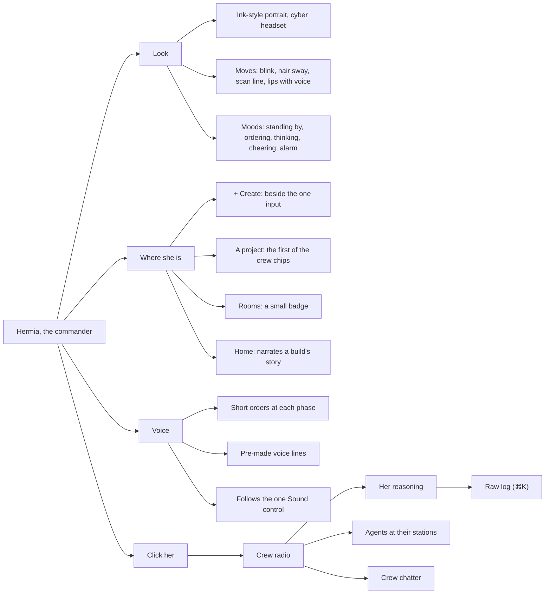

## 12. Flows by audience

The main path for each audience, start to finish. Every builder starts on Home and ends back on Home.

**Just make it**

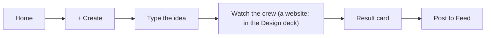

**Design**

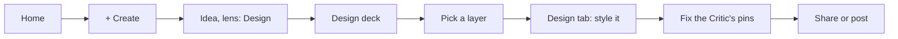

**Develop**

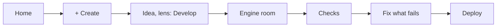

**Game**

```mermaid
flowchart LR
  d0[Home] --> d1["+ Create"] --> d2["Idea, lens: Game"] --> d3[Game room] --> d4[Play] --> d5[Tweak the feel] --> d6[Post to Feed]
```

**Mix**

```mermaid
flowchart LR
  e0[Home] --> e1["+ Create"] --> e2["Idea, lenses: Design + Develop"] --> e3[Design deck] --> e4[Engine room] --> e5[Open the app]
```

**Launch**

```mermaid
flowchart LR
  f0[Home] --> f1["+ Create"] --> f2["Idea, lens: Launch"] --> f3[Site] --> f4[Promo video] --> f5[Posts] --> f6[Post to Feed]
```

**Collaborator**

```mermaid
flowchart LR
  h0[Discover] --> h1[Open boards] --> h2[A board] --> h3[Ask to join] --> h4[The host accepts] --> h5[Pin an idea] --> h6["Build it → + Create"] --> h7["Credited on the build"]
```

**Jam entrant**

```mermaid
flowchart LR
  i0[Discover] --> i1[Jams] --> i2["This week's jam"] --> i3["Join → + Create"] --> i4[Build] --> i5[Post as an entry] --> i6[Votes] --> i7[Winners on Home]
```

**Feed visitor**

```mermaid
flowchart LR
  g0[Home] --> g1[Swipe] --> g2[A build that grabs you] --> g3[Its assets and story] --> g4[Remix] --> g5["+ Create"]
```

## 13. How deep it goes

| Path | Layers |
|---|---|
| Swarm › + Create › The idea › Lens chip › Design › Its canvas › Design deck › Layers › A section › An element › Design tab › Appearance › Fill › Token › Where else it is used | 14 |
| Swarm › Projects › A card › Its canvas › Progress › Make › Pages › Designer › Decided › Why › Prompt and model › Raw log | 13 |
| Swarm › + Create › The idea › Lens chip › Game › Its canvas › Game room › Tweak › Feel › Gravity › Slider › Value in the code › Who set it and why | 12 |
| Swarm › Home › For you › A build › Its story › Chapters › Before and after › The prompt | 7 |
| Swarm › Home › For you › A build › Its assets › Sprites and art › One asset › Use it in + Create | 7 |
