# Site maps and flows

Every screen of Swarm as one tree. Hermes opens the **Feed**, the way Kresilo opens on its home feed; the Studio
is inside it, reached through **+ Create** (a new build) or **Projects** (your builds). The Feed works like
TikTok: one build per screen, swipe for the next, and the build's own visuals and assets do the talking.

Each layer shows 2–4 choices, and the tree goes as deep as it needs to: the deepest paths are 14 layers (see
[RULES.md](RULES.md) rule 2). A dotted line jumps to another branch. Update this file when you add a layer or
move a branch.

Status: **agreed direction** (owner, 2026-11-09). Lens names follow [AUDIENCE.md](AUDIENCE.md).

## 1. The whole product

The same Feed opens from Hermes (with + Create and your Projects) and on the web at swarm.design-bakery.com
(where Remix and + Create hand off to Hermes).

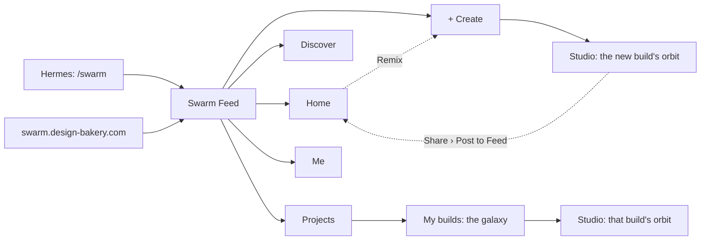

## 2. Navigation

Five slots, always in the same place: a bottom bar on a phone, a left rail on a desktop. Four places and one
primary action, + Create, in the middle.

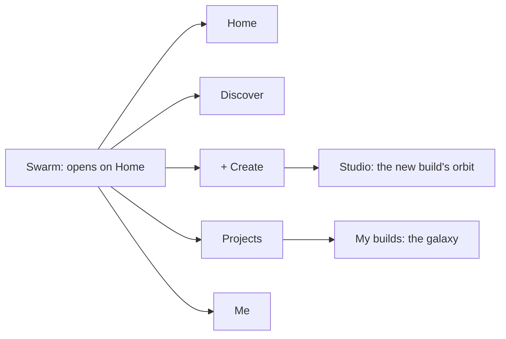

## 3. Home

One build fills the screen and plays itself (a game demo, a site scrolling, a film clip). The only text is the
maker and the title. No descriptions: the assets and the story are pictures and clips.

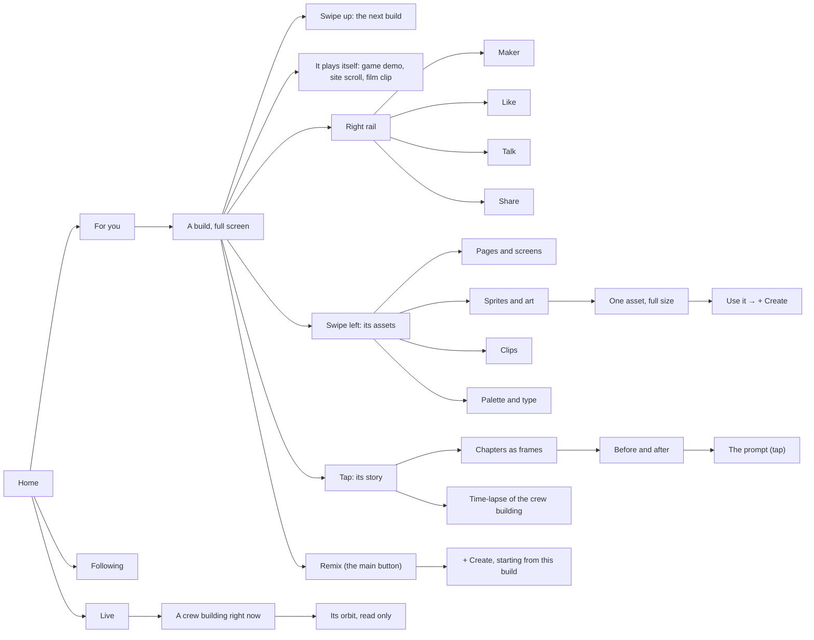

## 4. Discover

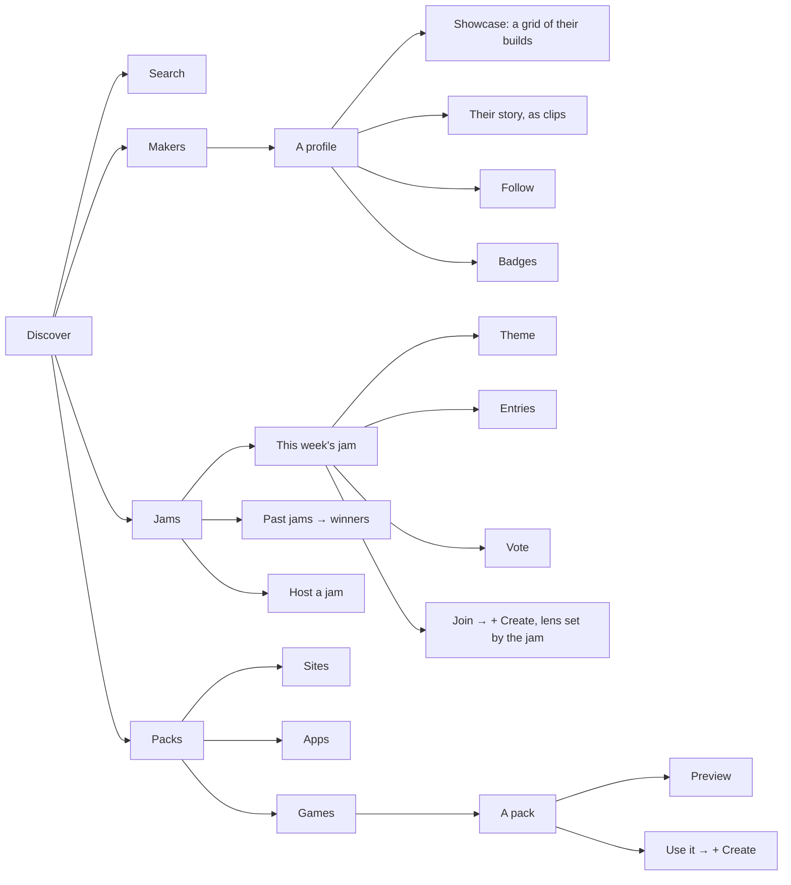

## 5. + Create

The one way to start a build. Hermia sits beside the input; the input becomes the chat inside the build.

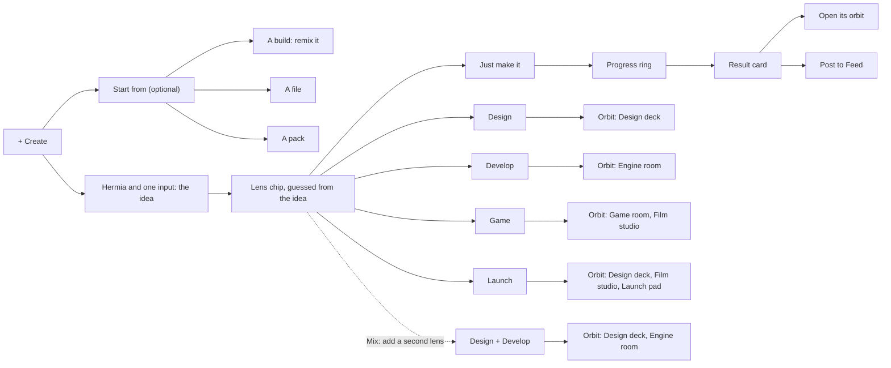

## 6. Projects

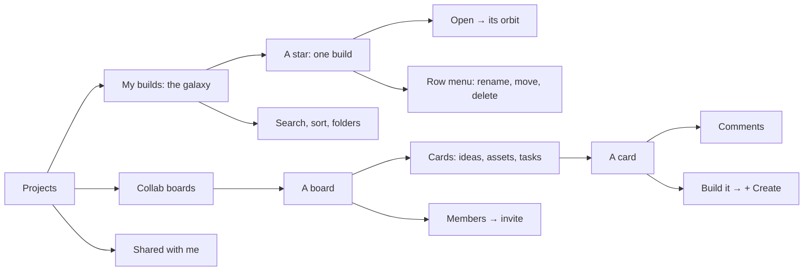

## 7. Me

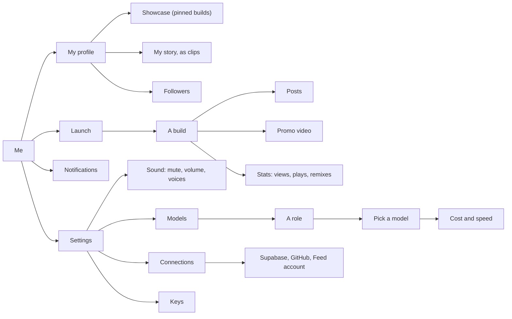

## 8. The orbit (one build)

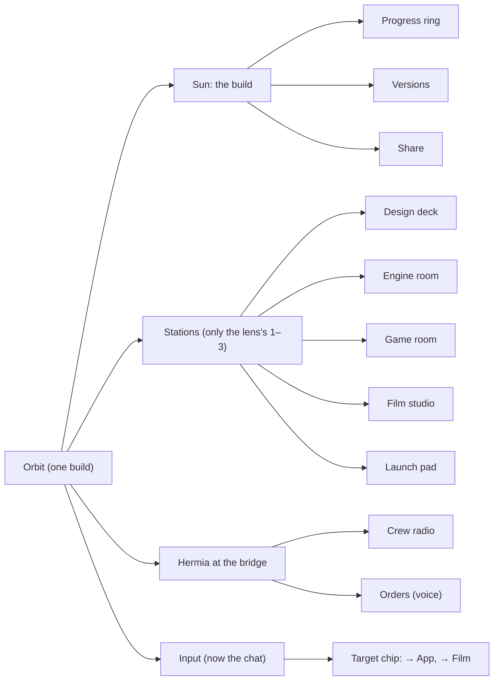

The way home is always there and is not a branch: the breadcrumb (`Home › Projects › build › room › …`), the
logo (back to Home) and Esc.

## 9. The sun: progress, versions, share

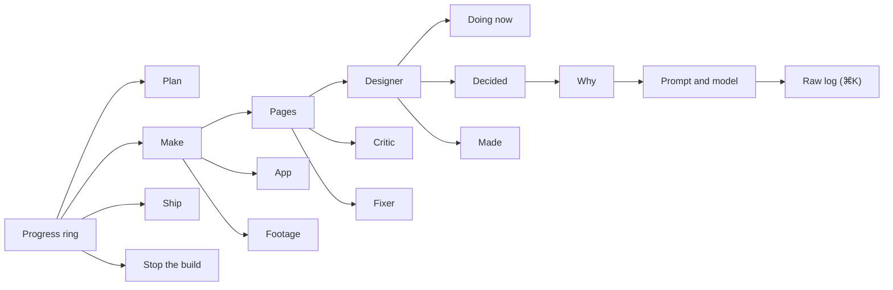

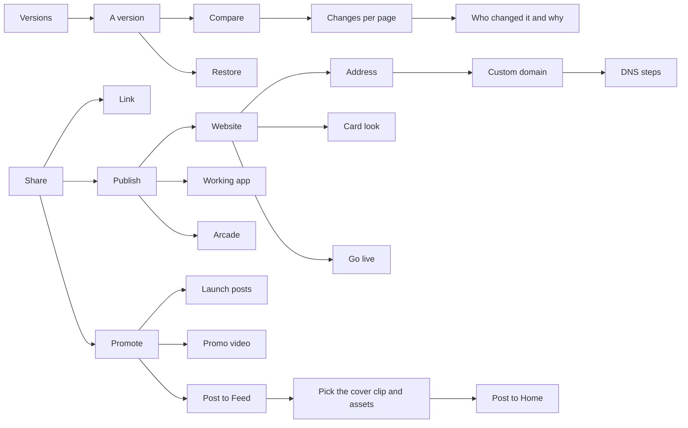

## 10. The rooms

### Design deck

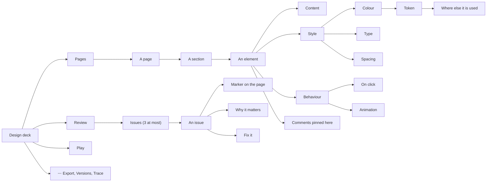

### Engine room

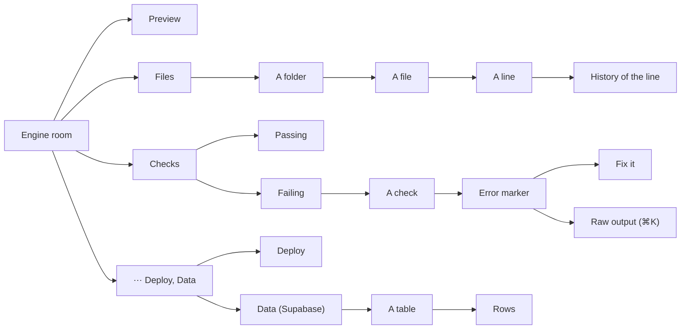

### Game room

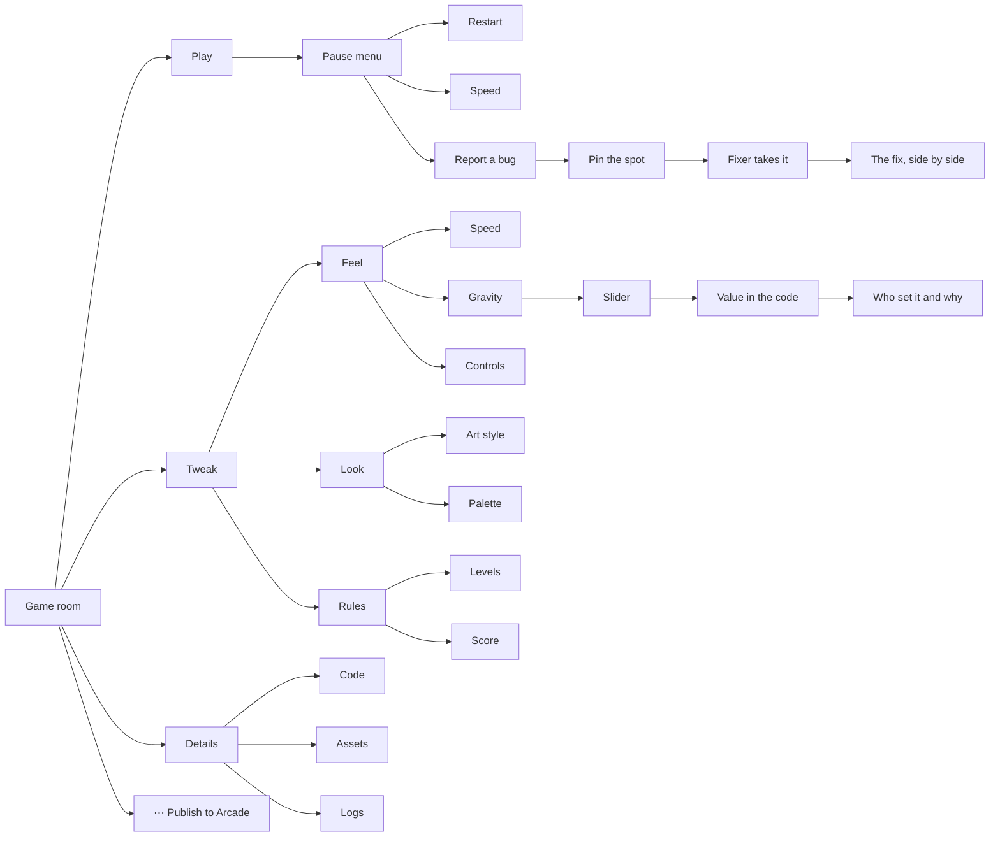

The 7-step game wizard is gone. Its questions become the Tweak branch, asked after the first playable build.

### Film studio and Launch pad

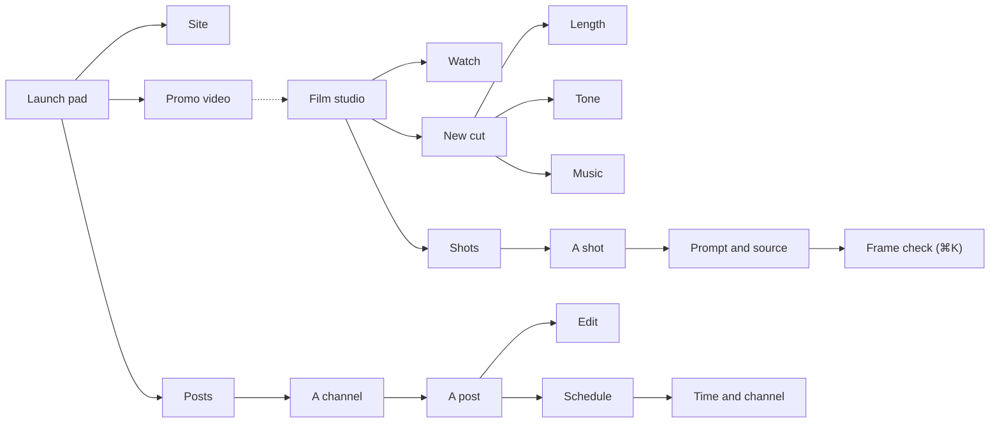

## 11. Hermia, the commander

Hermia leads the crew. She is our own character: the owner's reference was an ink-style anime portrait, and we
take the look (bold black ink on white, flat, one accent colour, a cyber headset), not that character, per the
original-content rule.

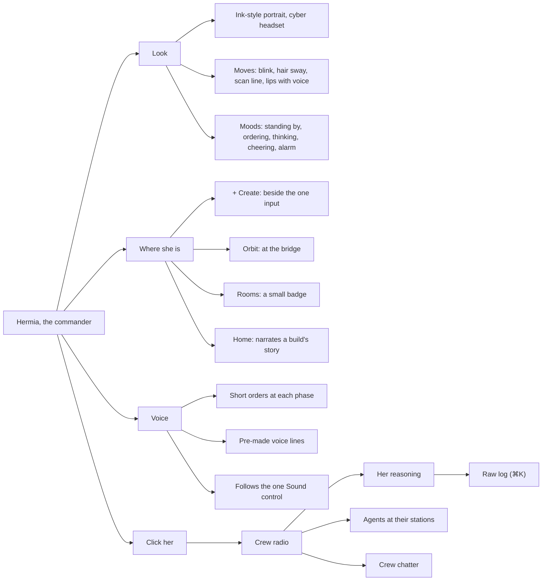

## 12. Flows by audience

The main path for each audience, start to finish. Every builder starts on Home and ends back on Home.

**Just make it**

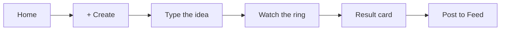

**Design**

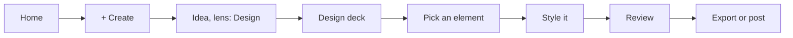

**Develop**

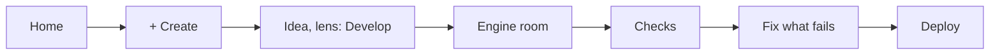

**Game**

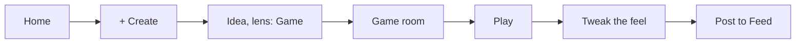

**Mix**

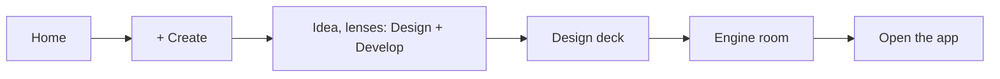

**Launch**

```mermaid
flowchart LR
  f0[Home] --> f1["+ Create"] --> f2["Idea, lens: Launch"] --> f3[Site] --> f4[Promo video] --> f5[Posts] --> f6[Post to Feed]
```

**Feed visitor**

```mermaid
flowchart LR
  g0[Home] --> g1[Swipe] --> g2[A build that grabs you] --> g3[Its assets and story] --> g4[Remix] --> g5["+ Create"]
```

## 13. How deep it goes

| Path | Layers |
|---|---|
| Swarm › + Create › The idea › Lens chip › Design › Orbit › Design deck › Pages › A page › A section › An element › Style › Colour › Token › Where else it is used | 14 |
| Swarm › Projects › My builds › A star › Its orbit › Sun › Progress › Make › Pages › Designer › Decided › Why › Prompt and model › Raw log | 13 |
| Swarm › + Create › The idea › Lens chip › Game › Orbit › Game room › Tweak › Feel › Gravity › Slider › Value in the code › Who set it and why | 12 |
| Swarm › Home › For you › A build › Its story › Chapters › Before and after › The prompt | 7 |
| Swarm › Home › For you › A build › Its assets › Sprites and art › One asset › Use it in + Create | 7 |
