# Site maps and flows

Every screen of the Studio and the Feed as one tree. Each layer shows 2–4 choices, and the tree goes as deep as
it needs to: the deepest paths are 13 layers (see [RULES.md](RULES.md) rule 2). A dotted line jumps to another
branch. Update this file when you add a layer or move a branch.

Status: **proposal for the owner to discuss** (2026-11-09). Lens names follow [AUDIENCE.md](AUDIENCE.md).

## 1. The whole product

Two homes: the Studio (private, where you make things) and the Feed (public, where builds are shown off,
told as stories, remixed and worked on together). Hermes opens either one.

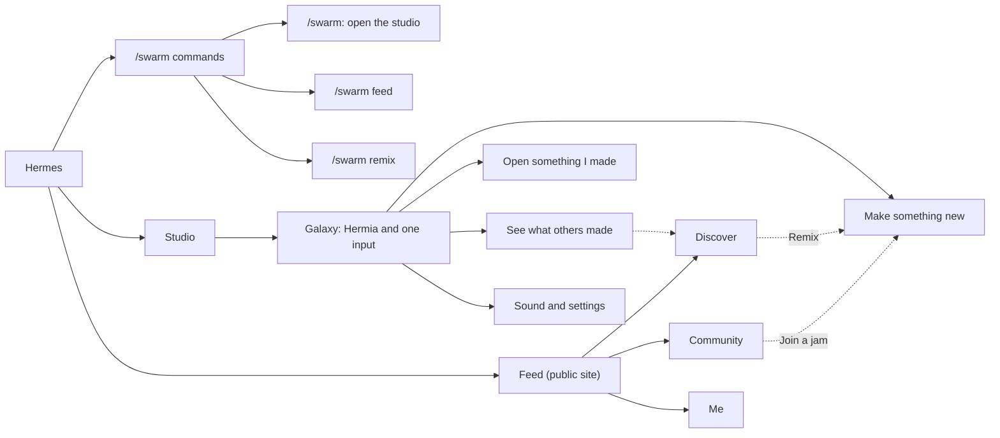

At rest the galaxy shows the stars, Hermia beside the one input, and four edge icons. Typing in the input is
**Make something new**; the stars and Search are **Open something I made**; the Feed icon is **See what
others made**; Sound and ⚙ are **Sound and settings**.

## 2. Make something new

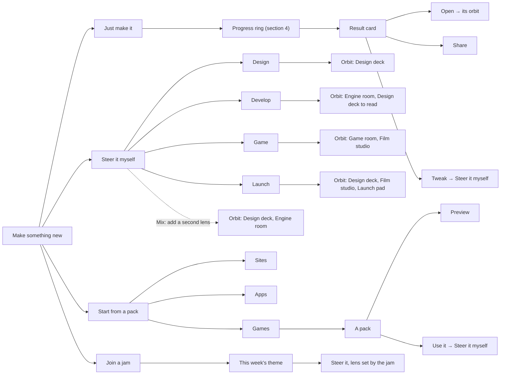

## 3. The orbit (one build)

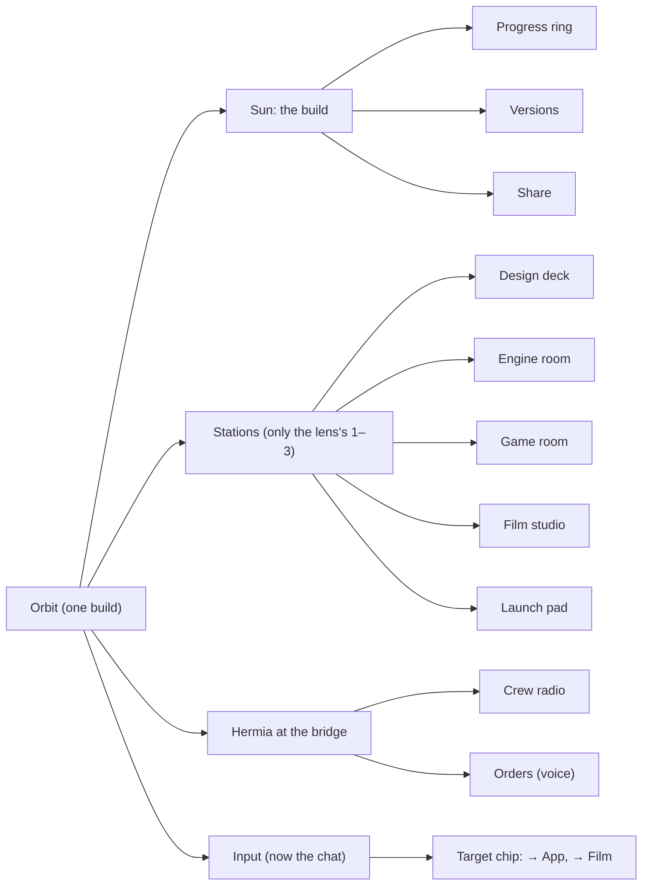

The way home is always there and is not a branch: the breadcrumb (`Galaxy › build › room › …`), the logo and
Esc.

## 4. The sun: progress, versions, share

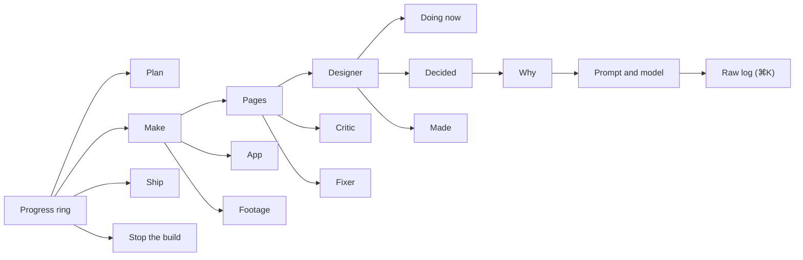

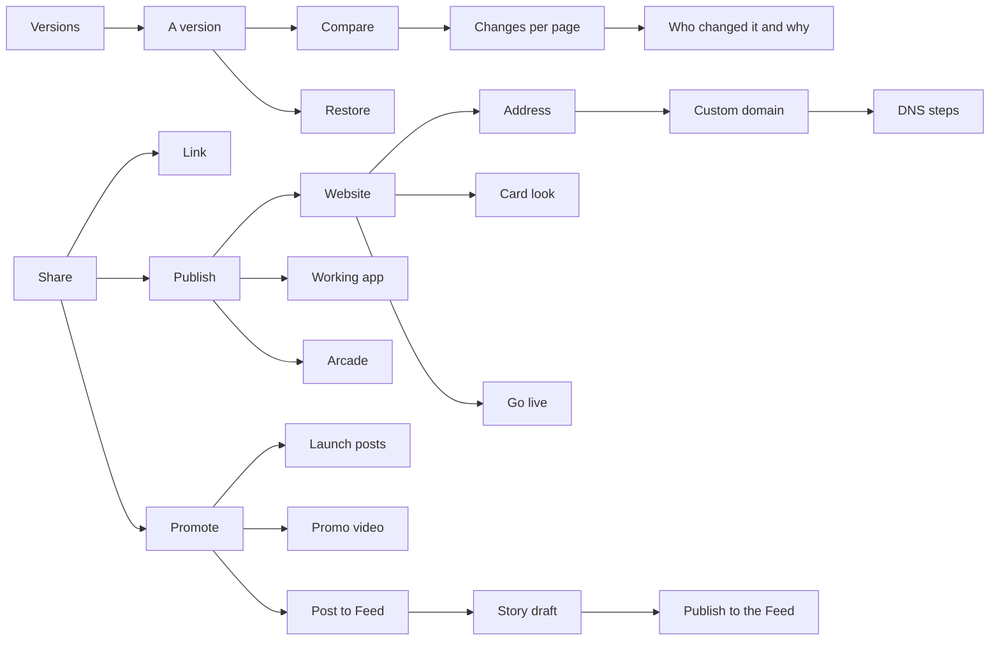

## 5. The rooms

### Design deck

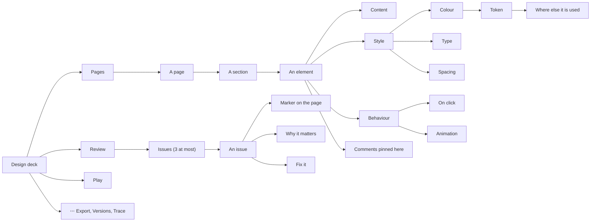

### Engine room

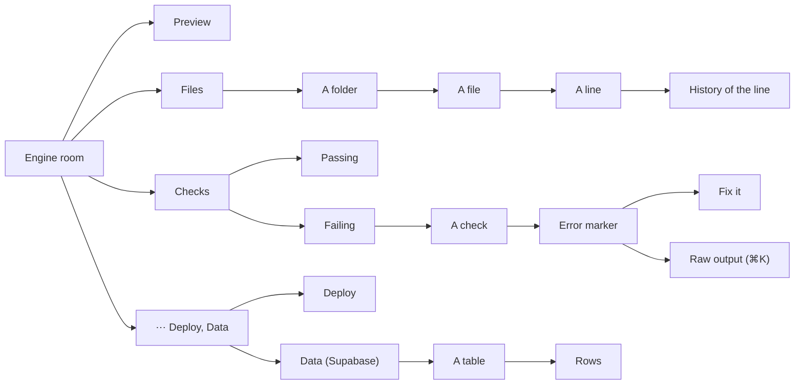

### Game room

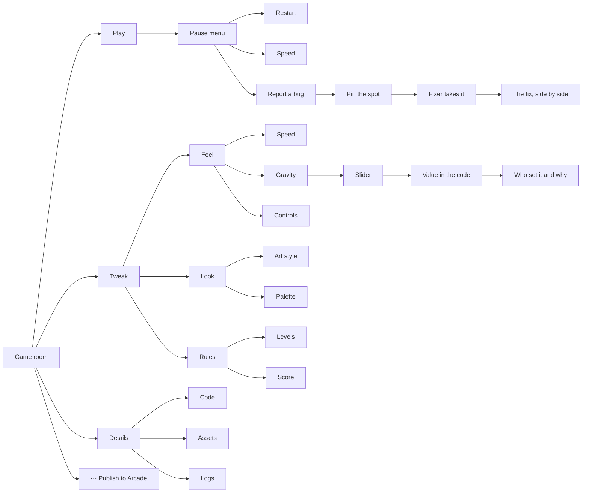

The 7-step game wizard is gone. Its questions become the Tweak branch, asked after the first playable build.

### Film studio and Launch pad

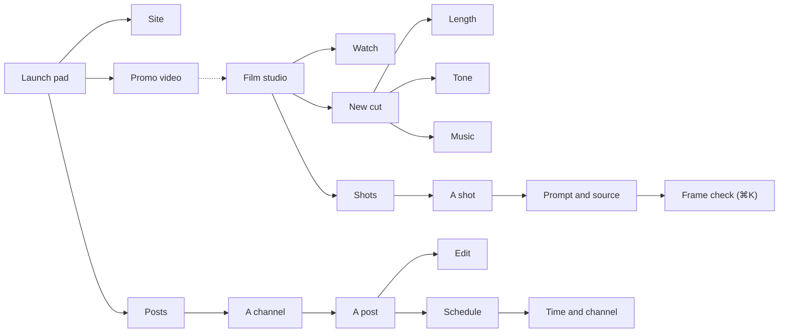

## 6. Open something I made, sound and settings

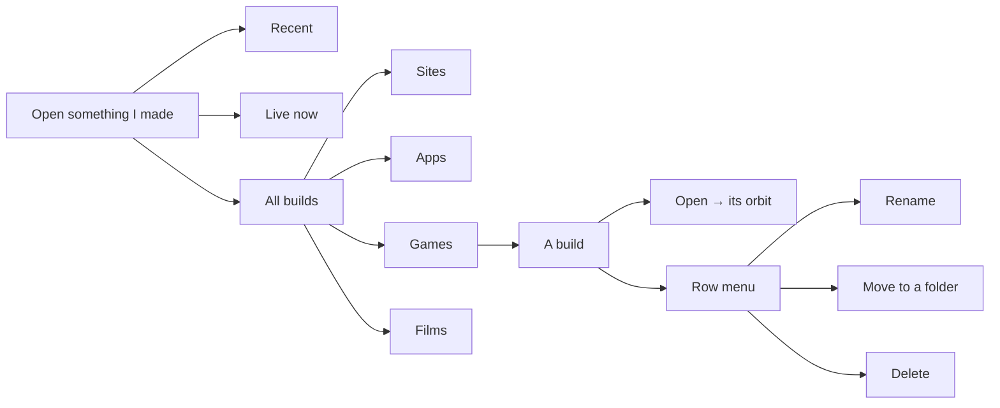

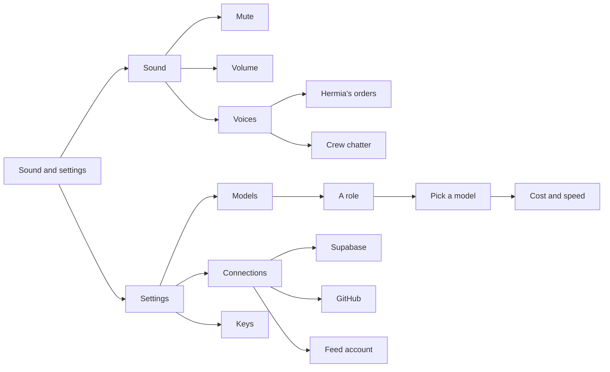

## 7. The Feed: the social side

The public site at swarm.design-bakery.com: show off builds, tell how they were made, remix, run jams, plan
together on boards, and market what you made. Its top bar has three choices: Discover, Community, Me.

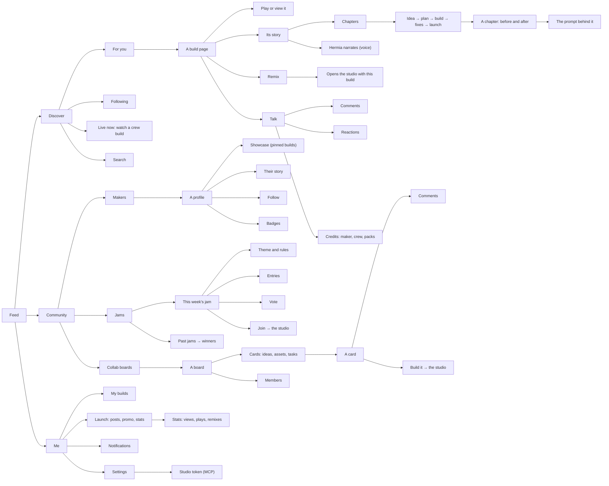

## 8. Hermia, the commander

Hermia leads the crew. She is our own character: the owner's reference was an ink-style anime portrait, and we
take the look (bold black ink on white, flat, one accent colour, a cyber headset), not that character, per the
original-content rule.

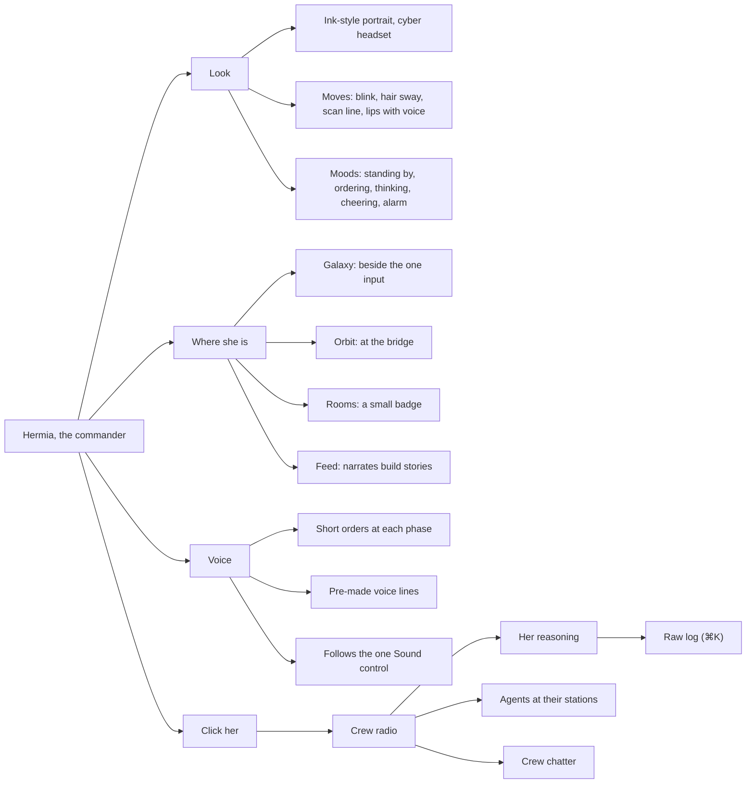

## 9. Flows by audience

The main path for each audience, start to finish.

**Just make it**

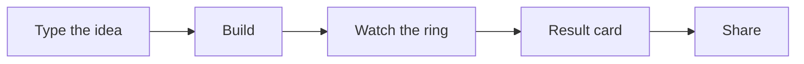

**Design**

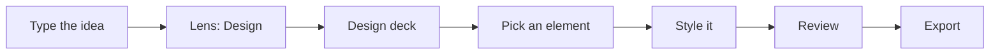

**Develop**

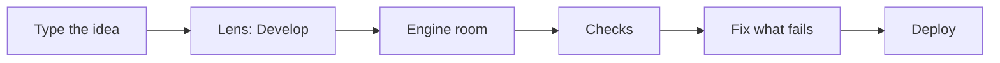

**Game**

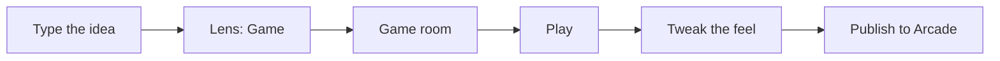

**Mix**

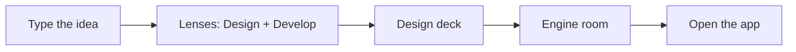

**Launch**

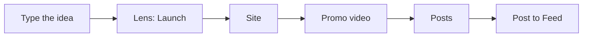

**Feed visitor**

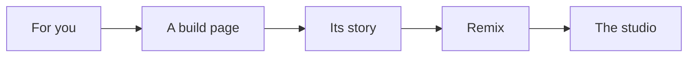

## 10. How deep it goes

| Path | Layers |
|---|---|
| Galaxy › Make › Steer › Design › Orbit › Design deck › Pages › A page › A section › An element › Style › Colour › Token › Where else it is used | 13 |
| Galaxy › Make › Steer › Design › Orbit › Sun › Progress › Make › Pages › Designer › Decided › Why › Prompt and model › Raw log | 13 |
| Galaxy › Make › Steer › Game › Orbit › Game room › Tweak › Feel › Gravity › Slider › Value in the code › Who set it and why | 11 |
| Galaxy › Make › Steer › Launch › Orbit › Sun › Share › Publish › Website › Address › Custom domain › DNS steps | 11 |
| Feed › Discover › For you › A build page › Its story › Chapters › Idea to launch › A chapter › The prompt behind it | 8 |
